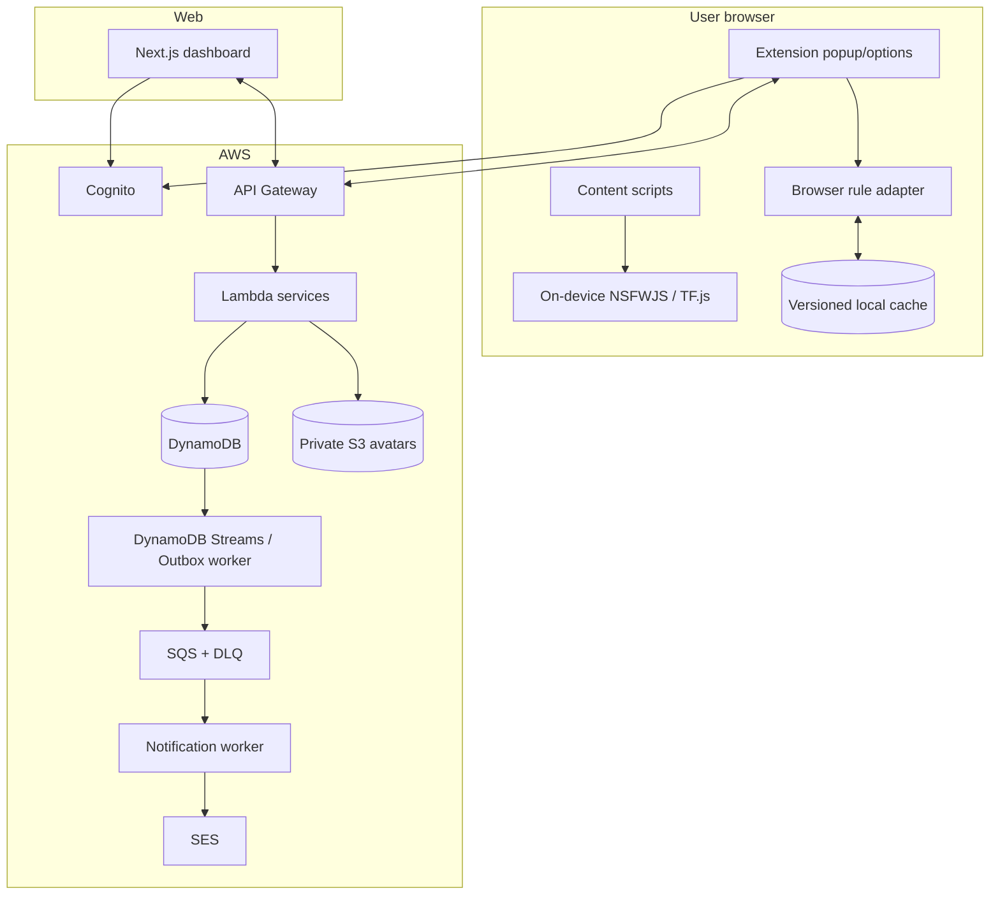

# Resolve

> **Take every thought captive.**

**Resolve** is a planned privacy-first, Christian-inspired browser protection and voluntary accountability platform. It combines **on-device AI media blurring**, **group-based website restrictions**, and **consent-based accountability notifications** to support intentional digital habits.

**Repository:** https://github.com/jervilangelo/resolve  
**Status:** Product and technical planning; features below are **planned**, not claims of an existing implementation.  
**Master specification:** [docs/MASTER_PLAN.md](docs/MASTER_PLAN.md) — authoritative functional, security, API, data, and delivery blueprint.

## Why Resolve?

The name draws inspiration from Jonathan Edwards's *Resolutions* (1722). The tagline references **2 Corinthians 10:5**: taking every thought captive to obey Christ. Resolve is a practical aid to accountability, **not** a substitute for spiritual formation, the work of the Holy Spirit, or trusted relationships.

## Product overview

| Component | Planned technology | Responsibility |
|---|---|---|
| Browser extension | WXT, React, TypeScript, Manifest V3 + Firefox adapter | Local AI blur, browser-level blocking, rule sync, navigation detection |
| Web dashboard | Next.js App Router, TypeScript | Accounts, groups, invitations, admin domain console, privacy preferences |
| API | API Gateway, Lambda, TypeScript | Authorization, group and rule management, minimal event ingestion |
| Identity | Amazon Cognito | Registration, verified email, sign-in, recovery |
| Persistence | DynamoDB | Groups, memberships, domains, policies, consents, event outbox |
| Media storage | Private S3 | Profile/group avatars only — never browsing images |
| Notifications | DynamoDB Streams, Lambda, SQS, SES | Durable, consent-aware generic emails |
| Hosting & IaC | Amplify Hosting, Terraform | Dashboard deployment and reproducible infrastructure |
| Tests | Vitest, Playwright, browser integration tests | Policy, privacy, workflow, and cross-browser validation |

## Core principles

1. **On-device content analysis:** images and supported video frames are classified locally; browsing media is not sent to AWS.
2. **Three domain categories:** platform-maintained essential exemptions; admin-only non-negotiable blocks; additional blocks that admins **and members may add without approval**.
3. **Admin-only domain removal:** only admins can remove group restrictions. Only admins see the full group domain list in the ordinary UI/API.
4. **Consent-based accountability:** each member chooses `PRIVATE`, `SELECTED`, or `EVERYONE`; recipients must consent; sharing may be one-way or bilateral.
5. **Exactly two v1 alert triggers:** qualifying user navigation to a non-negotiable domain, and group departure/removal. Additional blocked-domain hits do not alert by default.
6. **No browsing details in alerts:** no visited domain, URL, page title, screenshot, or browsing history in notification payloads or minimal activity events.
7. **Honest limitations:** user-controlled browser extensions are bypassable; local enforcement rules cannot be made perfectly secret from technically skilled users.

## System architecture



## Roles and permissions

| Action | Admin | Member |
|---|---|---|
| Create group / manage group branding | Yes | No |
| Invite / remove members | Yes | No |
| View group members | Yes | Yes |
| View complete restricted-domain list | Yes | **No** |
| Add/remove non-negotiable domains | Yes | No |
| Add additional blocked domain | Yes | **Yes, immediately** |
| Remove additional blocked domain | Yes | No |
| Set own sharing preferences | Yes | Yes |
| Leave group | Yes, subject to last-admin rule | Yes |

A member's domain submission gets a generic acknowledgment; it must not reveal whether a domain already existed or which category it belongs to. The admin console is the only standard interface that enumerates domains.

## Domain policy

**Priority:** protected essential service exemption → admin non-negotiable block → additional group block → allow by group policy.

The initial protected-service registry should cover Facebook, Messenger, YouTube, Gmail, Outlook, Google authentication/Drive/Meet, Microsoft 365, and Teams, with tested host dependencies. These services are **exempt from group domain blocking**; the platform does not promise they are immune to unrelated browser, network, or security controls. Parent/wildcard restrictions that would indirectly block essential services must be rejected or compiled with safe exceptions.

The extension enforces host/domain restrictions, **not system-wide DNS filtering**. DNS resolver addresses and arbitrary IP addresses are not accepted as domain block entries in v1. Use IDNA normalization, public-suffix validation, safe subdomain matching, versioned rules, and offline cached enforcement.

## AI content protection

- Observe ``, CSS/background images where feasible, and supported video frames.
- Load a bundled model locally (NSFWJS + TensorFlow.js as a proof-of-concept candidate).
- Apply a temporary protective blur while classification is pending when practical; keep blur for content above the configured risk threshold.
- Use throttled inference, deduplication, lazy loading, and safe failure behavior.
- Document cross-origin media/canvas restrictions, video limitations, false positives/negatives, and performance budgets.
- Do **not** market the model as comprehensive protection against all explicit content, phishing, malware, or harmful sites.

## Accountability and notifications

**Sharing modes:**

| Mode | Delivery rule |
|---|---|
| `PRIVATE` | No accountability alert |
| `SELECTED` | Only explicitly selected, consenting group recipients |
| `EVERYONE` | All other consenting group members |

Sharing is independently configured per member; if A chooses B and B chooses A, accountability is bilateral. Administrators cannot override a member's privacy choice. Recipient consent and revocation are required.

**Trigger A — non-negotiable navigation:** a qualifying, intentional top-level navigation is blocked locally. The extension sends a minimal event, and the backend checks membership, policy, recipient consent, rate limits, and deduplication before queuing a **generic** alert. Do not use debug-only rule-match APIs as production evidence; avoid alerts for background requests, redirects, and uncertain events.

**Trigger B — group departure:** backend captures pre-departure sharing and recipient consent, atomically updates membership and records a notification outbox item, then asynchronously delivers eligible generic departure notices. This also covers admin-initiated removals. A private member produces no accountability alert.

**Example notification:** “A member of your accountability group triggered a non-negotiable website restriction.” or “A member has left your accountability group.” The system may include the member's display name and group name, but never the restricted domain or URL.

## Recommended monorepo layout

```text
resolve/
├── README.md
├── docs/
│   └── MASTER_PLAN.md
├── apps/
│   ├── extension/              # WXT + React + TS
│   │   ├── entrypoints/        # popup, background, content, options
│   │   └── features/           # ai-filter, rules, sync, auth, events
│   └── dashboard/              # Next.js App Router
├── services/
│   ├── api/                    # Lambda handlers / domain services
│   └── notification-worker/    # Outbox, SQS, SES
├── packages/
│   ├── contracts/              # Zod schemas and DTOs
│   ├── policy-engine/          # Domain normalization / precedence
│   ├── ui/                     # Shared UI
│   └── config/                 # Shared TS/lint/test configuration
├── infra/
│   └── terraform/              # Dev/prod modules
├── tests/
│   ├── e2e/
│   ├── security/
│   └── browser-compat/
└── .github/workflows/
```

## Implementation roadmap

| Phase | Target | Definition of done |
|---|---|---|
| 1. Foundation | Week 1 | Monorepo, extension shell, dashboard, CI, IaC skeleton |
| 2. Local AI | Weeks 2–3 | Image blur and limited video proof of concept, no media uploads |
| 3. Auth & groups | Weeks 4–5 | Cognito, group lifecycle, roles, invitations |
| 4. Domain engine | Weeks 6–7 | Essential exemptions, confidential blocklist, admin/member write rules, browser enforcement |
| 5. Accountability | Week 8 | Three sharing modes, consent, selected/mutual relationships |
| 6. Notifications | Weeks 9–10 | Both triggers, outbox, SQS/SES, dedupe and rate limiting |
| 7. QA/security | Weeks 11–12 | Cross-browser tests, policy bypass checks, privacy audit |
| 8. Beta | Weeks 13–14 | Production infrastructure, store packaging, monitored limited release |

**Timeline is an estimate**, not a commitment; browser compatibility, video inference, store review, and rule-event reliability are major uncertainties.

## MVP acceptance checklist

- [ ] Local image and supported video classification without uploading media
- [ ] Login, registration, verified email, group creation/join/leave
- [ ] Admin/member role authorization enforced server-side
- [ ] Essential services cannot be blocked by group rules
- [ ] Members can add additional domains without approval
- [ ] Only admins can enumerate/remove domains
- [ ] Extension enforces versioned rules offline and syncs on reconnect
- [ ] Private, Selected, Everyone, consent and mutual accountability work
- [ ] Qualifying non-negotiable navigation produces consent-aware generic alert
- [ ] Group departure/removal produces consent-aware generic alert
- [ ] No browsing URLs, domains, page titles, screenshots or history in events/emails
- [ ] Retries, idempotency, TTL, and consent revocation tested
- [ ] Chrome, Brave, Edge, Firefox builds verified

## Security and product limitations

- Browser extensions on personal devices are **not tamper-proof**; users can disable, remove, or inspect them.
- The member-facing blocklist can be hidden, but rules delivered to a user-controlled browser may be inspected or inferred. **Do not promise absolute secrecy.**
- An authenticated extension event is **not cryptographic proof** of intentional browsing; alert copy should avoid accusation.
- Local AI can make mistakes and cannot guarantee comprehensive media coverage.
- No uninstall/heartbeat surveillance, device-wide DNS enforcement, doomscroll tracking, or general browsing history collection is planned for v1.
- Avoid putting sensitive details in CloudWatch logs, analytics, traces, or error reporting.

## Documentation and project governance

[**MASTER_PLAN.md**](docs/MASTER_PLAN.md) is the authoritative planning artifact. It contains functional requirements, API contracts, schema design, trust boundaries, detailed workflows, edge cases, acceptance tests, decisions, open questions, and phased delivery tasks. Update it when scope or architectural decisions change; keep this README as the approachable repository entry point.

## License and contribution status

License, public contribution policy, support contacts, production URLs, and extension store listings are **TBD**. No license or deployment is implied by this planning document.