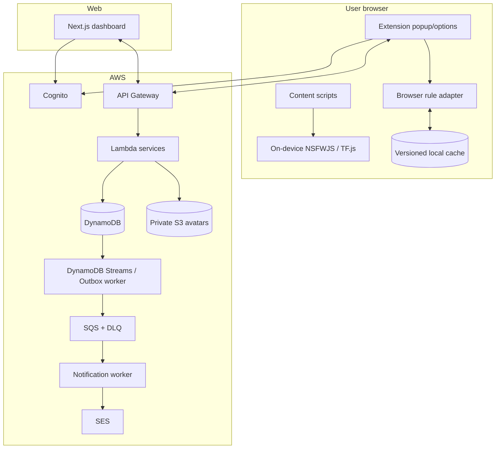

# Resolve

<picture>
  <source media="(prefers-color-scheme: dark)" srcset="assets/branding/logo/horizontal-dark.svg">
  
</picture>

> **Take every thought captive.**

**Resolve** is a privacy-focused browser protection and accountability platform that empowers believers to establish healthier digital boundaries. It integrates **locally processed AI content detection**, **customizable website blocking**, and **consent-based group accountability**, all while keeping personal browsing activity private.

**Repository:** https://github.com/jervilangelo/resolve  
**Status:** Product and technical planning; features below are **planned**, not claims of an existing implementation.  
**Master specification:** [docs/MASTER_PLAN.md](docs/MASTER_PLAN.md) — authoritative functional, security, API, data, and delivery blueprint.

## Branding


The logo and icon assets are available in [assets/branding](assets/branding):

- [Logos](assets/branding/logo): horizontal, compact, stacked, tagline, and symbol variants, with [PNG exports](assets/branding/logo/png).
- [App icons](assets/branding/icon), [browser extension icons](assets/branding/extension), and [web favicons](assets/branding/web).
- [UI icons](assets/branding/ui/icons), [social images](assets/branding/social), [store artwork](assets/branding/store), and [email headers](assets/branding/email).

## Why Resolve?

The name draws inspiration from Jonathan Edwards's *Resolutions* (1722). The tagline references **2 Corinthians 10:5**: taking every thought captive to obey Christ. Resolve is a practical aid to accountability, **not** a substitute for spiritual formation, the work of the Holy Spirit, or trusted relationships.

## About Resolve

Resolve is being designed for believers who desire to take their thoughts captive and walk in greater faithfulness to Christ, especially in the digital spaces where temptation can be private, persistent, and difficult to resist. Its central purpose is **mutual accountability among fellow brethren**: to make it easier for trusted brothers and sisters in Christ to encourage, exhort, pray for, and support one another.

God has given the local church and the fellowship of believers as means of encouragement and care (Hebrews 3:12–13; Galatians 6:1–2; James 5:16). **We encourage every believer to join, participate faithfully in, and be accountable within a sound local church**, where pastors, elders, and fellow members can know and care for them personally. **Resolve is only a supporting tool, never a replacement for membership, discipleship, pastoral oversight, fellowship, or accountability in the local church.** Its optional accountability groups, consent-based notifications, and browser safeguards are intended to make honest conversations and intentional habits easier. Accountability should be voluntary, gracious, respectful, and never used to shame or control someone.

### A tool, not the mortifier of sin

**Resolve is not the ultimate mortifier of sin.** No browser extension, blocked website, or automated notification can put sin to death on a person's behalf. Mortification is the believer's responsibility **by the Spirit and through God's grace** (Romans 8:13). Resolve is only a practical aid: it can help remove opportunities for temptation, encourage vigilance, and invite the support of fellow believers. It must never become a substitute for repentance, prayer, Scripture, personal responsibility, pastoral care, or dependence on Christ.

### Free, no ads, and privacy-conscious

Resolve is **intended to be free to use and free of advertising**. The goal is to make protection and accountability accessible without monetizing attention or browsing habits. The project is independently maintained, and the creator intends to sustain it as resources allow; continued availability and all future features cannot be guaranteed.

Authentication is **planned** through Amazon Cognito, with AWS-managed security controls, encrypted transport (HTTPS/TLS), encryption at rest for applicable backend data, and appropriate access controls. Passwords should be handled by the identity provider rather than stored in the application's own database. These are **design commitments**, not claims that an unlaunched system has already been audited or is invulnerable. **No screenshots, screen recordings, camera recordings, or files from your local machine are sent to other group members or included in notifications.** Resolve does not plan to capture or share your desktop screen or record your activity. Its planned AI blur detection uses **on-device image classification**: a model packaged with the extension examines supported images (and feasible video frames) inside your browser, produces a local classification score, and blurs content when a configured threshold is met. The images and frames are **not uploaded to AWS or sent to fellow group members for classification**. The classification is intended to run without a remote AI inference service, reducing exposure of sensitive media. This is a design goal that must be verified through network tests before release; local processing does not eliminate all security risks, and classification can be inaccurate. Accountability emails must not contain visited URLs, page titles, screenshots, or browsing history.

### When accountability notifications are sent

Resolve plans **only two notification triggers**:

1. **Attempted access to an admin-banned website:** When a user intentionally attempts a qualifying top-level navigation to a website on their group's **admin non-negotiable blocklist**, the extension blocks the visit and may send a **generic accountability email** to recipients who have consented under that user's sharing settings. This is **not** triggered by AI blur detections, ordinary browsing, background page requests, or websites on the additional member-submitted blocklist. A browser-reported attempt is not absolute proof of user intent.
2. **Leaving or being removed from a group:** An eligible generic group-departure notification may be sent according to the member's sharing settings and recipient consent immediately before departure.

**No screenshots, recordings, visited website names, full URLs, or browsing histories are shared in these notifications.** The email indicates only the applicable event category, subject to the user's privacy preferences. Private mode sends no accountability notifications.

### Supporting Resolve

A **voluntary donation option is planned**, potentially using a GCash payment link or QR code belonging to the project creator. The exact payment method and link will be added only after verification. Donations will be optional, will not unlock exclusive protection or accountability features, and will not be required to create an account or use Resolve. Any donation flow should clearly identify the recipient and disclose the relevant payment provider's privacy practices. No payment information should be collected by Resolve unnecessarily.

### Our commitments

- **Consent before disclosure:** Users choose their sharing policy, and recipients must agree to receive notifications.
- **Privacy by design:** Do not capture or share local screenshots or recordings; minimize event data, do not sell browsing data, and do not upload webpage media for AI classification.
- **Accessible by intention:** No advertising and no paid feature tiers are planned.
- **Honest limitations:** Protection can be bypassed and AI can make mistakes; the tool is support, not a guarantee of holiness or safety.
- **Faithful stewardship:** Maintain security, transparency, and reliability as resources allow.

## Product overview

| Component | Planned technology | Responsibility |
|---|---|---|
| Browser extension | WXT, React, TypeScript, Manifest V3 + Firefox adapter | Local AI blur, browser-level blocking, rule sync, navigation detection |
| Web dashboard | Next.js App Router, TypeScript | Accounts, groups, invitations, admin domain console, privacy preferences |
| API | API Gateway, Lambda, TypeScript | Authorization, group and rule management, minimal event ingestion |
| Identity | Amazon Cognito | Registration, verified email, sign-in, recovery |
| Persistence | DynamoDB | Groups, memberships, domains, policies, consents, event outbox |
| Media storage | Private S3 | Profile/group avatars only — never browsing images |
| Notifications | DynamoDB Streams, Lambda, SQS, SES | Durable, consent-aware generic emails |
| Hosting & IaC | Amplify Hosting, Terraform | Dashboard deployment and reproducible infrastructure |
| Tests | Vitest, Playwright, browser integration tests | Policy, privacy, workflow, and cross-browser validation |

## Core principles

1. **On-device content analysis:** images and supported video frames are classified locally; browsing media is not sent to AWS.
2. **Three domain categories:** platform-maintained essential exemptions; admin-only non-negotiable blocks; additional blocks that admins **and members may add without approval**.
3. **Admin-only domain removal:** only admins can remove group restrictions. Only admins see the full group domain list in the ordinary UI/API.
4. **Consent-based accountability:** each member chooses `PRIVATE`, `SELECTED`, or `EVERYONE`; recipients must consent; sharing may be one-way or bilateral.
5. **Exactly two v1 alert triggers:** qualifying user navigation to a non-negotiable domain, and group departure/removal. Additional blocked-domain hits do not alert by default.
6. **No browsing details in alerts:** no visited domain, URL, page title, screenshot, or browsing history in notification payloads or minimal activity events.
7. **Honest limitations:** user-controlled browser extensions are bypassable; local enforcement rules cannot be made perfectly secret from technically skilled users.

## System architecture



## Roles and permissions

| Action | Admin | Member |
|---|---|---|
| Create group / manage group branding | Yes | No |
| Invite / remove members | Yes | No |
| View group members | Yes | Yes |
| View complete restricted-domain list | Yes | **No** |
| Add/remove non-negotiable domains | Yes | No |
| Add additional blocked domain | Yes | **Yes, immediately** |
| Remove additional blocked domain | Yes | No |
| Set own sharing preferences | Yes | Yes |
| Leave group | Yes, subject to last-admin rule | Yes |

A member's domain submission gets a generic acknowledgment; it must not reveal whether a domain already existed or which category it belongs to. The admin console is the only standard interface that enumerates domains.

## Domain policy

**Priority:** protected essential service exemption → admin non-negotiable block → additional group block → allow by group policy.

The initial protected-service registry should cover Facebook, Messenger, YouTube, Gmail, Outlook, Google authentication/Drive/Meet, Microsoft 365, and Teams, with tested host dependencies. These services are **exempt from group domain blocking**; the platform does not promise they are immune to unrelated browser, network, or security controls. Parent/wildcard restrictions that would indirectly block essential services must be rejected or compiled with safe exceptions.

The extension enforces host/domain restrictions, **not system-wide DNS filtering**. DNS resolver addresses and arbitrary IP addresses are not accepted as domain block entries in v1. Use IDNA normalization, public-suffix validation, safe subdomain matching, versioned rules, and offline cached enforcement.

## AI content protection

- Observe ``, CSS/background images where feasible, and supported video frames.
- Load a bundled model locally (NSFWJS + TensorFlow.js as a proof-of-concept candidate).
- Apply a temporary protective blur while classification is pending when practical; keep blur for content above the configured risk threshold.
- Use throttled inference, deduplication, lazy loading, and safe failure behavior.
- Document cross-origin media/canvas restrictions, video limitations, false positives/negatives, and performance budgets.
- Do **not** market the model as comprehensive protection against all explicit content, phishing, malware, or harmful sites.

## Accountability and notifications

**Sharing modes:**

| Mode | Delivery rule |
|---|---|
| `PRIVATE` | No accountability alert |
| `SELECTED` | Only explicitly selected, consenting group recipients |
| `EVERYONE` | All other consenting group members |

Sharing is independently configured per member; if A chooses B and B chooses A, accountability is bilateral. Administrators cannot override a member's privacy choice. Recipient consent and revocation are required.

**Trigger A — non-negotiable navigation:** a qualifying, intentional top-level navigation is blocked locally. The extension sends a minimal event, and the backend checks membership, policy, recipient consent, rate limits, and deduplication before queuing a **generic** alert. Do not use debug-only rule-match APIs as production evidence; avoid alerts for background requests, redirects, and uncertain events.

**Trigger B — group departure:** backend captures pre-departure sharing and recipient consent, atomically updates membership and records a notification outbox item, then asynchronously delivers eligible generic departure notices. This also covers admin-initiated removals. A private member produces no accountability alert.

**Example notification:** “A member of your accountability group triggered a non-negotiable website restriction.” or “A member has left your accountability group.” The system may include the member's display name and group name, but never the restricted domain or URL.

## Recommended monorepo layout

```text
resolve/
├── README.md
├── docs/
│   └── MASTER_PLAN.md
├── apps/
│   ├── extension/              # WXT + React + TS
│   │   ├── entrypoints/        # popup, background, content, options
│   │   └── features/           # ai-filter, rules, sync, auth, events
│   └── dashboard/              # Next.js App Router
├── services/
│   ├── api/                    # Lambda handlers / domain services
│   └── notification-worker/    # Outbox, SQS, SES
├── packages/
│   ├── contracts/              # Zod schemas and DTOs
│   ├── policy-engine/          # Domain normalization / precedence
│   ├── ui/                     # Shared UI
│   └── config/                 # Shared TS/lint/test configuration
├── infra/
│   └── terraform/              # Dev/prod modules
├── tests/
│   ├── e2e/
│   ├── security/
│   └── browser-compat/
└── .github/workflows/
```

## Implementation roadmap

Development is organized into **ten milestone-based phases with no fixed weeks or deadlines**. See [DEVELOPMENT_ROADMAP.md](docs/DEVELOPMENT_ROADMAP.md) for detailed tasks, deliverables, and completion criteria, beginning with branding and ending with production launch.

## MVP acceptance checklist

- [ ] Local image and supported video classification without uploading media
- [ ] Login, registration, verified email, group creation/join/leave
- [ ] Admin/member role authorization enforced server-side
- [ ] Essential services cannot be blocked by group rules
- [ ] Members can add additional domains without approval
- [ ] Only admins can enumerate/remove domains
- [ ] Extension enforces versioned rules offline and syncs on reconnect
- [ ] Private, Selected, Everyone, consent and mutual accountability work
- [ ] Qualifying non-negotiable navigation produces consent-aware generic alert
- [ ] Group departure/removal produces consent-aware generic alert
- [ ] No browsing URLs, domains, page titles, screenshots or history in events/emails
- [ ] Retries, idempotency, TTL, and consent revocation tested
- [ ] Chrome, Brave, Edge, Firefox builds verified

## Security and product limitations

- Browser extensions on personal devices are **not tamper-proof**; users can disable, remove, or inspect them.
- The member-facing blocklist can be hidden, but rules delivered to a user-controlled browser may be inspected or inferred. **Do not promise absolute secrecy.**
- An authenticated extension event is **not cryptographic proof** of intentional browsing; alert copy should avoid accusation.
- Local AI can make mistakes and cannot guarantee comprehensive media coverage.
- No uninstall/heartbeat surveillance, device-wide DNS enforcement, doomscroll tracking, or general browsing history collection is planned for v1.
- Avoid putting sensitive details in CloudWatch logs, analytics, traces, or error reporting.

## Documentation and project governance

[**MASTER_PLAN.md**](docs/MASTER_PLAN.md) is the authoritative planning artifact. It contains functional requirements, API contracts, schema design, trust boundaries, detailed workflows, edge cases, acceptance tests, decisions, open questions, and phased delivery tasks. Update it when scope or architectural decisions change; keep this README as the approachable repository entry point.

## Copyright and source code permissions

**Copyright © 2026 Jervil Angelo De Leon. All rights reserved.**

Resolve is **proprietary, source-available only at the copyright owner's discretion, and not open source**. No permission is granted to copy, redistribute, modify, sublicense, sell, or reuse its source code without prior written authorization from the copyright owner. See [LICENSE](LICENSE) and [COPYRIGHT_NOTICE.md](docs/COPYRIGHT_NOTICE.md).

Public access to a GitHub repository does **not** mean the code is licensed for reuse. However, if the repository is public, people may still **view** its contents and GitHub may provide platform features such as forking subject to GitHub's terms. For genuinely confidential source code, use a **private repository**; copyright notices alone do not prevent access or copying.

Future source files should carry the copyright header described in [COPYRIGHT_NOTICE.md](docs/COPYRIGHT_NOTICE.md). No blanket permission for outside contributions is granted.
