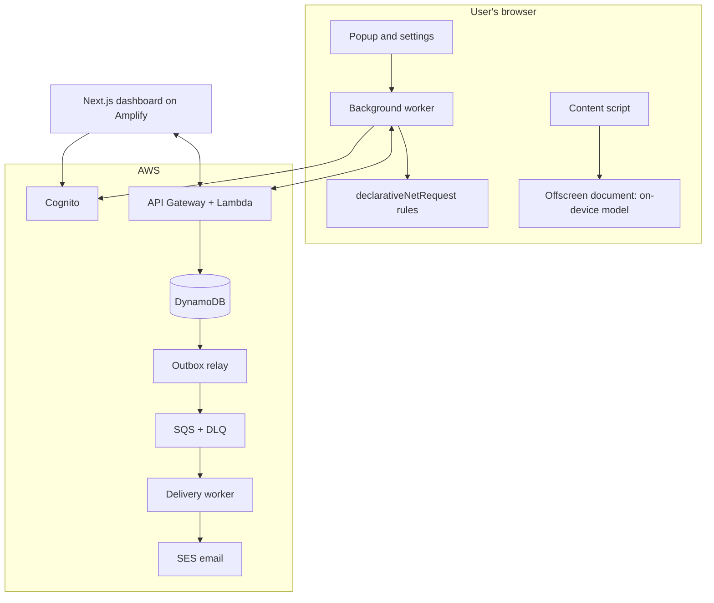

<!--
Resolve — Take every thought captive.
Copyright © Jervil Angelo De Leon. All rights reserved.
Proprietary source code. See LICENSE.
-->

# Developing Resolve

For contributors. Resolve is proprietary: reading the source is fine, reuse needs written
permission (see [LICENSE](../LICENSE)). Product requirements live in [MASTER_PLAN.md](MASTER_PLAN.md);
how work is done (agent roles, reviews) in [DEVELOPMENT_HANDBOOK.md](DEVELOPMENT_HANDBOOK.md).

## Repository layout

```text
apps/extension/          WXT + React MV3 extension (Chrome, Edge, Brave; Firefox build not shipped)
  entrypoints/           background, popup, options, content, offscreen, blocked, focus
  lib/                   auth, protection (group rules), focus, navigation (alerts), media filter
apps/web/                Next.js 16 website and dashboard (App Router, server-side session)
services/api/            Lambda HTTP API: accounts, groups, invites, domains, consent, rules, events
services/notifications/  Outbox relay and delivery worker (SQS, SES)
packages/contracts/      Zod schemas shared by API, web and extension
packages/domain-policy/  Domain normalisation, essential-service registry, precedence
packages/ui/             Design tokens and shared styles
packages/config/         Shared TypeScript, ESLint and test configuration
infrastructure/terraform/ modules/ (identity, api, data, notifications, hosting, domain, observability,
                          github-deploy, lambda, stack) and environments/ (dev, prod)
tests/e2e/               Playwright: website and real-extension specs
tests/integration/       Live API tests against a deployed stage
assets/branding/         Logos, icons, social and store artwork (synced into the apps)
scripts/                 Env generation, Lambda bundling, header check, brand and model sync
```

## How it works



**Group website blocking.** The extension fetches the active group's rule snapshot and installs two
dynamic block rules (non-negotiable and additional, IDs 1–99999) with the essential-service registry
in `excludedRequestDomains`. Rules are cached and keep enforcing offline; the extension re-syncs every
15 minutes and when the group changes.

| Action | Admin | Member |
| --- | --- | --- |
| Invite and remove members, rename or dissolve the group | Yes | No |
| See the full list of blocked websites | Yes | **No** |
| Add a website | Yes (either category) | Yes, immediately (additional) |
| Remove or recategorise a website | Yes | No |
| Choose own sharing and consent | Yes | Yes |
| Leave the group | Yes, unless the last admin | Yes |

Precedence: essential exemption > non-negotiable > additional. Member submissions get a generic
answer that never reveals whether a website was already listed. Rules on a user's device can be
inspected, so secrecy is never promised.

**On-device media blurring.** Optional; needs site access. The content script blurs images and
video until the NSFWJS MobileNetV2 model (TensorFlow.js, bundled under `public/models/nsfw`) running
in an offscreen document classifies them. No media leaves the browser; the media filter E2E checks
that no request is made. Accuracy notes: [AI_FILTER_EVALUATION.md](AI_FILTER_EVALUATION.md).

**Accountability alerts.** Off by default. Each member chooses Private, selected members or everyone;
each recipient must agree. Two core triggers:

- **Deliberate visit to a non-negotiable website.** Needs the optional `webNavigation` permission
  (the extension's alert setting). `lib/navigation.ts` treats only a top-level, user-started
  navigation blocked by the browser as deliberate, ignoring redirects, pop-ups, restores and
  prerenders. The event carries an ID, group ID, type, timestamp and rule version, never the website.
- **Leaving or being removed from a group.**

Plus two opt-in installation alerts (MASTER_PLAN §7.4), off by default for sender and recipient:
**removal** (the extension registers `runtime.setUninstallURL` with a random token in the URL
fragment; `/removed` relays it to `POST /v1/installations/removed`) and **inactivity** (hourly
check-ins; `services/api/src/handlers/inactivity.ts` runs hourly and alerts after 72 hours of
silence). Code: `apps/extension/lib/installation.ts`, `services/api/src/installations.ts`.

The backend re-checks membership, sharing and consent, applies a 10-minute cooldown and
deduplication, and emails a generic message (display name and group name, never the website).

**Focus Mode.** Personal and local: rule IDs 100000–100999, a persisted deadline with an alarm, no
network calls. With site access, blocked visits redirect to `focus.html`.

**Blocked pages.** After the browser reports `ERR_BLOCKED_BY_CLIENT`, the background swaps the tab to
`blocked.html` (group) or `focus.html` (Focus only). Group rules are untouched; the page URL carries
nothing about the site. Needs `webNavigation`.

Data stored and for how long: [qa/DATA_INVENTORY.md](qa/DATA_INVENTORY.md). Threats and mitigations:
[qa/THREAT_MODEL.md](qa/THREAT_MODEL.md).

## Set up

Requirements: Node 22 (`.nvmrc`), pnpm 10 (`corepack enable`), and Chrome, Edge or Brave for the
extension tests. Terraform and the AWS CLI only for infrastructure work.

```bash
pnpm install
pnpm web:env dev            # apps/web/.env.local from the dev stack's Terraform outputs
pnpm extension:env dev      # apps/extension/.env.local
pnpm dev:web                # http://localhost:3000
pnpm dev:extension          # WXT dev build with reload
```

Without the env files the website and extension still build; sign-in is reported unavailable.

## Check, test and build

| Command | What it does |
| --- | --- |
| `pnpm check` | Format check, copyright headers, lint, typecheck and unit tests (what CI runs first) |
| `pnpm lint` · `pnpm typecheck` · `pnpm test` | Each step across the workspace |
| `pnpm build` | Production builds of every package (website, extension for Chromium and Firefox, Lambdas) |
| `pnpm --filter @resolve/e2e e2e` | Playwright: `--project=web`, `web-mobile`, `extension` (build the extension first) |
| `RESOLVE_E2E_BROWSER=msedge\|brave …` | Run the extension suite in Edge or Brave |
| `pnpm integration` | Live API tests against the dev stack |

Every first-party source file starts with the header in [COPYRIGHT_NOTICE.md](COPYRIGHT_NOTICE.md)
(`pnpm check:headers`). Brand rules: [BRAND_GUIDELINES.md](BRAND_GUIDELINES.md). Shipping changes:
[RELEASING.md](RELEASING.md).

## Third-party notices

The bundled image model is NSFWJS by Infinite Red, Inc. (MIT); its license ships in the extension at
`models/nsfw/NOTICE.txt`. Other dependencies keep their own licenses in `node_modules`. Test
fixtures credit their sources in [tests/e2e/fixtures/media/NOTICE.md](../tests/e2e/fixtures/media/NOTICE.md).
