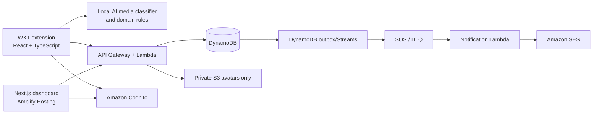

# Resolve — Development Handbook and AI Agent Operating Guide

> **Take every thought captive.** — 2 Corinthians 10:5  
> Repository: https://github.com/jervilangelo/resolve  
> Owner: Jervil Angelo De Leon  
> Copyright © 2026 Jervil Angelo De Leon. All rights reserved.  
> Status: Development handbook — distinguish verified scaffolding from future features.

## 1. Purpose of this document

This is the single practical working handbook for developing Resolve with **Claude Code as lead implementation agent** and **OpenAI Codex as secondary agent**. It combines developer responsibilities, existing repository state, product principles, confirmed functionality requirements, architecture, security/privacy rules, staged implementation, testing, Git workflow, and phase acceptance gates.

It supplements, **does not replace**, these existing authoritative documents:

- [`README.md`](../README.md): public project introduction, beliefs, privacy intent and user-facing scope.
- [`docs/MASTER_PLAN.md`](MASTER_PLAN.md): authoritative functional and technical requirements, flows, API and data design.
- [`docs/DEVELOPMENT_ROADMAP.md`](DEVELOPMENT_ROADMAP.md): phase ordering and acceptance targets. **No dates or week estimates.**
- [`docs/BRAND_GUIDELINES.md`](BRAND_GUIDELINES.md): approved branding and visual assets.
- [`docs/COPYRIGHT_NOTICE.md`](COPYRIGHT_NOTICE.md) and [`LICENSE`](../LICENSE): proprietary copyright rules.

If two documents conflict, **raise the conflict and reconcile it explicitly**. Treat latest approved user decisions as higher priority than obsolete passages; update the affected documents rather than quietly contradicting them. Do not assume an unimplemented feature works because a document describes it.

## 2. Project mission and Christian commitments

Resolve is a privacy-first, voluntary browser protection and Christian accountability system. The objective is to help believers hold one another accountable with trusted fellow brethren. God gives the fellowship of believers and the local church as means of mutual encouragement, exhortation, care and prayer (Hebrews 3:12–13; Galatians 6:1–2; James 5:16). Users are encouraged to join and faithfully participate in a sound **local church**, with meaningful accountability to its members and leaders. **Resolve does not replace the local church, fellowship, pastoral oversight, repentance, discipleship, Scripture or prayer.**

The tool does **not** ultimately mortify sin. The believer must pursue mortification by the Spirit and God's grace (Romans 8:13); software safeguards support the effort but cannot substitute for faithfulness or guarantee righteousness. The tagline is **“Take every thought captive.”** The identity takes inspiration from Jonathan Edwards's *Resolutions* and 2 Corinthians 10:5.

Resolve is intended to remain **free and without ads**. It may eventually provide an **optional GCash donation link/QR code** once verified; never hardcode an unverified payment recipient, collect payment credentials in Resolve, or imply that donating unlocks protections. Sustainability is an intention, not a guaranteed perpetual service commitment.

## 3. Verified repository state — do not recreate it

At inspection of `main` on 2026-11-23, the repository contains **actual Phase 1 scaffolding**, not just planning notes. Existing paths include:

| Area | Existing implementation/scaffold | Follow-up |
|---|---|---|
| Monorepo | `pnpm-workspace.yaml`, root `package.json`, `pnpm-lock.yaml`, Node version `.nvmrc` | Verify fresh installation and scripts instead of reinitializing |
| Extension | `apps/extension` using WXT, React, TS; `background.ts`, `content.ts`, popup, options, message contracts, status helpers, unit tests | Validate both browser build targets and permission minimality |
| Web | `apps/web` Next.js App Router, Tailwind, UI components, landing shell, environment helper | Confirm responsive branding, accessibility, and truthful “in development” states |
| Shared code | `packages/config`, `packages/contracts`, `packages/ui` | Reuse existing schemas, errors, colors, typography and contracts |
| API | `services/api/src` health handler, HTTP helper, logger, env module and tests | Expand only when later phase requires secured APIs |
| IaC | `infrastructure/terraform/environments/dev` and `prod` configurations | Validate Terraform offline; do not deploy or spend without permission |
| Automation | `.github/workflows/ci.yml` lint/typecheck/test/build/E2E plus Terraform format and validate | Review CI run outcomes before claiming pass |
| E2E | `tests/e2e` Playwright setup, web/extension specs | Use existing tests and add cases incrementally |
| Assets | `assets/branding/` finished logos, extension icons, web favicons, social/store/email artwork | **Branding is completed**; preserve exact visual system |
| Proprietary checks | `scripts/check-headers.mjs`, `docs/COPYRIGHT_NOTICE.md`, `LICENSE` | Use existing header validation rather than duplicating it |

**Important:** This inventory establishes file presence, not that every build passes or that AWS/AI/domain enforcement/accountability is implemented. Inspect commits, tests, package versions and code locally before asserting success. The repository currently has source code in a **public** GitHub repository; the proprietary license does not make that source confidential. If keeping the code unseen is required, switch repository visibility to private.

### Existing development commands (confirm locally)

```bash
corepack enable
pnpm install --frozen-lockfile
pnpm check               # formatting, proprietary headers, lint, typecheck, tests
pnpm build               # all workspace builds
pnpm e2e                 # Playwright E2E (requires browser setup)
pnpm dev:extension       # extension local development
pnpm dev:web             # web local development
pnpm assets:sync         # synchronize existing brand assets
```

The repository declares pnpm `10.34.9` and Node `>=22.12.0`; use `.nvmrc` for the intended Node version. Don't update pinned versions or dependencies without a need, and retain the lockfile.

## 4. Agent hierarchy and cost control

### 4.1 Claude Code — PRIMARY development owner

Claude owns architecture, requirement interpretation, implementation, integration, design decisions, code changes, and final sign-off. It reads the project documents and actual code first. **Claude does not delegate away overall responsibility.**

Primary Claude tasks: select the smallest coherent implementation batch; develop approved features; decide file/module boundaries; integrate branding and shared contracts; review Codex findings; fix confirmed defects; assess release gates; commit/push only after checks.

### 4.2 OpenAI Codex — SECONDARY independent support

Codex handles focused debugging, reproduction of errors, independent review, test creation or execution, TypeScript/lint errors, security/performance checks, copyright header checks, and low-risk refactoring when explicitly authorized. Delegate work that has a narrow input and clear expected output. By default **Codex should review without modifying files**; request patches only when useful, and ideally use a separate Git worktree.

**Do not claim that Codex ran unless its CLI/MCP integration actually ran.** Claude's ability to call Codex depends on installed tools, authentication, permissions and the current workspace. If unavailable, disclose that and run essential checks directly; never fabricate a second-agent review.

### 4.3 Recommended handoff protocol

1. Claude reads the targeted requirement IDs, relevant files and current `git status`.
2. Claude implements one small, verifiable vertical slice.
3. Claude runs the fastest relevant tests to catch obvious errors.
4. Claude delegates a **single concise review batch** to Codex: changed files, expected behavior, commands to run, negative/security tests, and requested findings format.
5. Codex returns prioritized findings with filenames, line numbers, reproduction, confidence and suggested remedy. No lengthy rewritten documentation.
6. Claude verifies the findings, corrects issues, and reruns affected checks. If needed, Codex independently validates the fix once.
7. Claude summarizes only material changes, test outcomes, limitations and commit status.

**Cost control:** avoid handoffs for trivial changes, repeated whole-repository scans, redundant parallel tests, verbose agent transcripts, speculative dependency upgrades, enormous context dumps, and duplicate docs. Use `git diff` and file paths rather than feeding the entire repository to both agents. Token savings are a target, not a reason to skip privacy or security testing.

### 4.4 Example Codex review instruction

```text
Review only the current diff in Resolve. Read docs/MASTER_PLAN.md requirements relevant to this change and the copyright policy. Do not edit files. Focus on correctness, security, privacy, TypeScript, browser compatibility and regressions. Run appropriate local tests if available. Return only prioritized actionable findings with path:line, reproduction, impact, and minimal fix. If no material findings, say so explicitly. Do not generate documentation.
```

### 4.5 File/branch ownership

- One write owner per file at a time; avoid concurrent Claude and Codex modifications in the same checkout.
- Prefer Codex read-only review or a separate worktree/branch; Claude merges approved changes.
- Never use force push or overwrite uncommitted user changes.
- No API keys, environment secrets, user credentials or personal browsing data in agent prompts, console logs, commits, screenshots or third-party evaluation systems.
- Check the privacy/data retention settings of any AI coding service before sharing sensitive code or data. Turning off training is not equivalent to zero processing or zero retention.

## 5. Confirmed MVP boundaries

### 5.1 Supported platforms

Desktop browser extension for **Chrome, Brave, Edge and Firefox**; Chromium Manifest V3 and Firefox-compatible adapter where needed. Dashboard via web application. Not OS-wide blocking, DNS filtering, mobile native app or uninstall-proof protection.

### 5.2 Roles and group policies

Two group roles: **Admin** and **Member**. Users may belong to multiple groups but select one active group for an extension installation in the MVP. Admin creates/manages groups and invites, manages members, sees the complete blocked-domain list, and may remove any blocked domain. Members join groups, can submit **additional blocked domains immediately with no approval**, cannot remove blocked domains and cannot enumerate the full list in ordinary UI or APIs. Return a generic submission result to prevent duplicate/category probing; acknowledge that browser-local rules on user-controlled devices can still be inspected or inferred.

**Enforcement precedence:**

1. **Platform protected essential allowlist** — exemptions for the designated essential services (Facebook, Messenger, YouTube, Gmail, Outlook, Microsoft 365, Google login/Drive/Meet, Teams and tested service dependencies).
2. **Admin non-negotiable blocked domains** — only admin adds/removes, and qualifying attempts can trigger an accountability alert.
3. **Additional blocked domains** — Admin or Member adds; admin removes; **never sends an alert by default**.
4. Otherwise permit navigation under group policy.

Validate hostname normalization, registrable-domain matching, IDNs, subdomains, public suffixes, wildcard interactions and policy rule limits. Essential-domain exemptions apply to Resolve's group rules, not all external internet controls.

### 5.3 Local AI image/video blur

Use **on-device AI image classification**, with an appropriate packaged model such as NSFWJS/TensorFlow.js if testing supports it. Detect supported DOM images and feasible video frames, handle lazy loading and dynamic pages, blur potentially explicit media locally, and bound CPU/GPU usage. No capturing/sharing desktop screenshots, screen recordings, camera recordings or files from the user's machine. No uploading webpage images or video frames to AWS, group admins, fellow members, or a remote classification service. The model should classify media in the browser and apply CSS or equivalent blurring; classification results stay local unless an explicitly approved new privacy design is adopted. Do not claim universal video coverage, perfect classification, or complete protection from bypasses.

### 5.4 Accountability privacy and sharing

Sharing policies per person:

- `PRIVATE` — default; no accountability alerts.
- `SELECTED` — alerts to selected group members who independently consented to receive them.
- `EVERYONE` — alerts to all eligible group members who independently consented.

Independent, one-way and mutual/bilateral accountability are allowed. Admins cannot override a member's sharing preferences. Consent can be revoked. No retroactive disclosure of previously private events. Use server-side recipient resolution and account for races when memberships or consents change.

### 5.5 EXACTLY two MVP notification triggers

**Trigger 1 — banned website access attempt.** On a qualifying intentional **top-level navigation attempt** to an **admin non-negotiable blocked domain**, block locally and emit a minimal authenticated event (subject to validated event rules). The backend verifies group membership/policy, cooldowns, deduplicates and checks consent before sending a generic alert. **Do not alert for** AI blurring, ordinary browsing, background requests, network resources, protected essential sites, or additional member-added blocks. Treat client-side reported intent as fallible, not cryptographic proof. Do not base production alerts on debug-only browser APIs.

**Trigger 2 — group departure.** When a member leaves or an admin removes them, capture the pre-departure sharing and recipient consent in an atomic/consistent backend workflow and queue an eligible generic alert. It must function even if the departed member's extension is offline. `PRIVATE` never sends an alert.

**Never include** visited domain, URL, path, page title, browser history, screenshot, recorded video, image or other sensitive media in activity event or email. Use event category and only the minimal approved identity context. Add no additional notification triggers without explicit scope approval. In particular: no tamper/uninstall, missing-heartbeat, AI blur, member-submitted site, or focus/doomscroll alerts.

### 5.6 User-facing privacy promises

AWS Cognito is planned for authentication and credential management; passwords should not be stored in the app's own DynamoDB tables. Use HTTPS/TLS, encryption-at-rest where appropriate, IAM least privilege, secure session storage, private S3 for user-uploaded group/profile pictures, minimal backend logs, data retention/TTL and security monitoring. These are engineering commitments to implement/test, **not proof of existing deployment, audits or absolute security**. Never conflate “local AI blur” with no browser permissions or with total privacy against all software on the machine.

## 6. Planned system architecture



**Technical starting point:** TypeScript strict, pnpm workspaces, WXT, React, Next.js App Router, Tailwind/shadcn, Zod contracts, Vitest, Playwright, GitHub Actions, Terraform and AWS serverless. Use the existing workspace structure rather than generating parallel copies of app or infrastructure folders.

### Data and API planning

Keep the current `docs/MASTER_PLAN.md` as the source of truth for exact schema/API contracts. Planned records include Users, Groups, Memberships, Invitations, ProtectedDomains, BlockedDomains, SharingPolicies, RecipientConsents, minimal ActivityEvents with TTL, NotificationOutbox/Jobs, and administrative Audit events. Planned endpoints include `/me`, `/groups`, `/groups/{id}`, invitations/acceptance, members, leave, domains, sharing, consent, extension rules/events and notification preferences. Secure every operation with identity, current group membership and role checks; treat account/group IDs from the request body as untrusted.

Notification architecture: atomically capture departure event and membership change; outbox/Streams → SQS with retry/DLQ → worker → SES. Avoid notification loss caused by deleting membership before recipient snapshots are calculated. Ingest browser events only after verified local and backend qualification; enforce idempotency, reasonable cooldowns, input/schema limits and deduplication.

## 7. Phase execution roadmap — no weeks or deadlines

**Phase 1 — Branding and foundation.** **Branding is already complete:** logo sets, color/typography tokens, extension/web/store/social/email assets and [`BRAND_GUIDELINES.md`](BRAND_GUIDELINES.md) exist. **Engineering foundation is also partially or substantially scaffolded**: WXT, Next, shared contracts/UI, API health route, Terraform environments, CI, Vitest and Playwright files are present. Do not regenerate. Validate/repair what exists. Exit: fresh install, formatting, header checks, lint, types, unit tests, extension/web builds, Chromium+Firefox build checks where supported, E2E, Terraform fmt/validate, and branding verification. Record only actual passing results.

**Phase 2 — Local AI content protection.** Create a small on-device model proof of concept; measure memory, runtime, accuracy and false-positive behavior; integrate blur of supported images/video frames; test zero media uploads, dynamic content, performance and browser limitations. Exit: reliable, measured demo without media exfiltration.

**Phase 3 — Identity and groups.** Implement Cognito login/registration, group lifecycle, role enforcement, invites, multiple membership/one active group, and account/session security. Exit: tested authenticated two-user lifecycle and negative-role tests.

**Phase 4 — Domain protection.** Implement platform essential exemptions, non-negotiable and additional blocks, admin/member role boundaries, local cache and browser-specific enforcement. Exit: precedence, offline behavior, member no-approval add and admin-only remove/list tests pass.

**Phase 5 — Accountability and consent.** Implement PRIVATE/SELECTED/EVERYONE sharing, consent revocation, recipient eligibility, independent and bilateral selections. Exit: policy/authorization matrix passes without retroactive exposure.

**Phase 6 — Notification reliability and triggers.** Implement the exactly two alerts, event qualification, backend recipient resolution, atomic group-departure outbox, SQS/SES retry/DLQ and privacy-safe generic email templates. Exit: integration and negative tests pass, no visited site or media data in event/email payloads.

**Phase 7 — Security and cross-browser validation.** Privacy threat review, role escalation, browser rule quotas, extension disabling limitations, cross-origin video, AI errors, offline states, consent races, fault injection, Playwright/Vitest, and browser-store permission review. Exit: critical risks resolved and limitations accurately communicated.

**Phase 8 — Deployment and launch.** Deploy only with approval, verify AWS costs and SES sending identity, production configuration, compliance disclosures, extension store packaging and store assets, monitored beta, and support/feedback flow. Exit: supported beta path works end-to-end. **No calendar estimates.**

The existing roadmap may use a finer-grained ten-phase breakdown; use that for project tracking, while the above groups work into eight implementation milestones. These are organizational descriptions, **not a rewrite of approved scope**.

## 8. Phase 1 detailed execution checklist (current work)

### 8.1 Establish baseline and avoid accidental overwrites

- [ ] `git status --short`, `git branch --show-current`, `git log -5 --oneline`, `git remote -v`.
- [ ] Verify repo's current `main` and outstanding local work. **Do not discard user changes.**
- [ ] Inspect `README.md`, master plan, roadmap, brand guidelines, copyright policy and actual package scripts.
- [ ] Inventory existing branding and source architecture; do not rerun scaffolding generators over existing apps.

### 8.2 Validate local environment and dependencies

- [ ] Use the repository Node version and Corepack/pnpm compatible with `packageManager`.
- [ ] `pnpm install --frozen-lockfile`; check package audit only in an approved, safe manner.
- [ ] Run `pnpm check` and `pnpm build`; fix root causes, not just suppression warnings.
- [ ] Validate Windows developer compatibility, including path handling and scripts.

### 8.3 Extension verification

- [ ] Run `pnpm dev:extension`; verify popup/options render and existing logo/icons match approved files.
- [ ] Build Chromium and Firefox using actual WXT scripts/configuration; do not assume a Firefox build passes.
- [ ] Inspect background/content script entrypoints and ensure they do not claim nonexistent AI/blocking.
- [ ] Review manifest permissions; ask for the minimum necessary when features are introduced, not speculative broad access.
- [ ] Test any messaging/contracts and browser runtime behavior in an appropriate installed test environment.

### 8.4 Dashboard verification

- [ ] Run `pnpm dev:web`; confirm responsive layout, error/404 states, local fonts and proper assets.
- [ ] Verify color contrast, keyboard access, dark/light logo variants, metadata, favicons and Open Graph.
- [ ] Keep user-facing feature statuses accurate: currently scaffolded is not production-ready.

### 8.5 Shared packages and API baseline

- [ ] Check `@resolve/config`, `@resolve/contracts`, `@resolve/ui`; reuse schemas/tokens instead of duplicating.
- [ ] Verify API health handler, error normalization, environment validation and structured logs.
- [ ] Ensure no production credentials embedded in source or examples.

### 8.6 Terraform and CI baseline

- [ ] Run `terraform fmt -check -recursive` and `terraform validate` with backend disabled where appropriate.
- [ ] Verify dev/prod isolation, placeholder example configs and `.gitignore` handling of state/secrets.
- [ ] Inspect GitHub Actions checks and Playwright browser installation; document only actual results.
- [ ] **Do not execute `terraform apply` or create billable resources without explicit approval.**

### 8.7 Intellectual property and source comments

- [ ] Run `pnpm check:headers` and inspect the script's coverage.
- [ ] Original project files use required copyright headers appropriate to language; preserve shebangs/directives.
- [ ] Do not modify third-party/vendor or generated files merely to insert personal copyright notices.
- [ ] Keep `.gitignore`, secrets protection and package license `UNLICENSED` consistent with proprietary intent.
- [ ] Review **public repository visibility** with owner; do not mistake copyright notice for access restriction.

### 8.8 Finish criteria

Phase 1 is done only after the **existing** scaffold builds and tests with no outstanding critical issue, branding is correctly connected, environment is reproducible, and any unresolved browser/platform gaps are explicitly recorded. If only some checks run, report them as partial. Do not invent Codex review results or claim launch-ready features.

## 9. Recommended testing strategy

**Fast loops:** TypeScript compile, lint, formatting, header validator and focused Vitest. **Integration:** API authorization/membership and outbox idempotency tests with synthetic data. **Browser:** Playwright, local extension runs, explicit Chromium/Firefox validation; use static pages to test blocked-domain behavior and images with legitimate test fixtures. **Security:** permission matrix, attempts to enumerate hidden domains, token spoofing, race conditions, replay, rate limits, essential-domain dependencies, and group-departure consent consistency. **Privacy:** inspect all HTTP requests, console telemetry, logs, email payloads and artifacts to ensure no screenshot/video frames, site names or URL history escape. **Reliability:** SQS retry, DLQ, partial failures, offline rule cache, reconnection, revoked membership.

Use realistic **synthetic data**. Never ask agents to test with actual personal browsing history, explicit private media, real church member credentials or other sensitive user content.

### Required review output from Codex

```text
Scope reviewed:
Commands executed and outcomes:
Critical/high/medium findings (file:line, evidence, how to reproduce):
Privacy/security risks:
Compatibility/performance risks:
Fixes suggested (minimal):
Unverified claims or blockers:
```

## 10. Git, deployment, and approvals

- Work on small scoped commits; mention phase and change in messages (`feat(extension): ...`, `test(...): ...`, `fix(...): ...`).
- Check diffs for accidentally committed secrets, private URLs, credentials and personal data.
- Do not force-push. Avoid committing unrelated generated files, test recordings or third-party assets that have incompatible licenses.
- Production deployments and AWS provisioning require explicit approval of costs and scope. Local Terraform validation is allowed.
- Main-branch pushes should follow user authorization and repo policy; never overwrite concurrent changes.
- Donation links must be verified and clearly voluntary before publishing.
- Store platform/extension permissions are subject to their actual policies; audit them before release.
- No performance, security, or uptime guarantee should appear in public messaging without evidence.

## 11. Agent startup instruction (paste into Claude Code)

```text
You are the PRIMARY engineering agent for Resolve, repository https://github.com/jervilangelo/resolve. Open docs/DEVELOPMENT_HANDBOOK.md, docs/MASTER_PLAN.md, docs/DEVELOPMENT_ROADMAP.md, docs/BRAND_GUIDELINES.md, README.md, LICENSE and docs/COPYRIGHT_NOTICE.md, then inspect the actual working tree. Existing branding is COMPLETE and the Phase 1 monorepo has already been scaffolded; do not recreate either. Start with Phase 1 validation/repair of existing work. Own architecture and core coding. Delegate focused read-only reviews, debugging, tests and copyright-header audits to Codex CLI if actually available, in narrow batches; otherwise transparently proceed with essential checks and report that Codex was unavailable. Do not fabricate tests, review results, deployments or cost savings. Preserve all existing source and branding. No weeks/deadlines, no unnecessary docs, no unapproved AWS spend, no secrets, and no force pushes. Follow strict privacy and exactly two notification triggers. Make coherent changes, validate, then report only useful outcomes and verified commit status.
```

## 12. Definition of success

Resolve should offer reliable local media blurring and group domain policies, optional consent-based accountability, and private browser event handling while encouraging users toward **real local-church fellowship**. Every release should honor the person's agency, protect their device data, and candidly explain technical limitations. Claude remains accountable for engineering quality; Codex reduces routine review/debug workload when available. Branding and source ownership are respected, and no stage is deemed complete without test evidence.