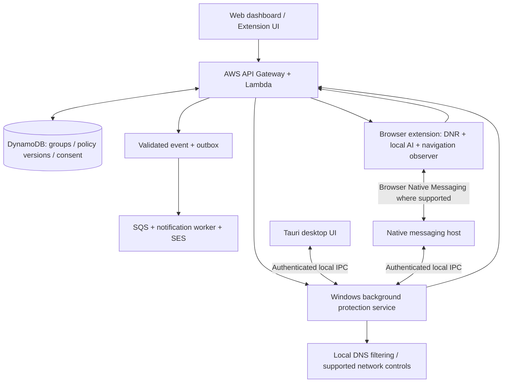

# Resolve Hybrid Desktop — Proposed System Architecture

> **Status:** Proposal only · **Target:** Post-launch (candidate Phase 12) · **Platform:** Windows-first
>
> This document does **not** describe an implemented feature, change the MVP's two notification triggers, or authorize covert monitoring. It supplements, rather than supersedes, [MASTER_PLAN.md](MASTER_PLAN.md) and [DEVELOPMENT_ROADMAP.md](DEVELOPMENT_ROADMAP.md).

## 1. Executive decision

**Feasible, with qualifications.** Resolve already has a pnpm monorepo, WXT extension, Next.js dashboard, AWS Cognito/API Gateway/Lambda/DynamoDB backend, shared domain-policy package, and consent-aware notification pipeline. A Windows companion can reuse these foundations while adding substantial new operating-system engineering.

**Product objective:** An optional, explicitly installed Windows desktop companion enforces the **same authoritative group restrictions** as the extension across supported network applications, including browsers in private mode, and continues enforcing supported domain restrictions when the extension or desktop UI is closed. It may submit narrowly qualified desktop-originated accountability events; it must **not** equate DNS lookups with intentional navigation.

**Non-goals:** Guaranteed tamper resistance on user-administered devices; hidden monitoring; collecting browser history; sending domains/URLs to accountability recipients; bypassing recipient consent; preventing emergency uninstall; automatically deleting accounts on disable/uninstall; universal coverage of VPNs, encrypted DNS, IP connections, or all applications.

## 2. Existing architecture and reuse

| Existing component | Current responsibility | Hybrid use |
| --- | --- | --- |
| `apps/extension` (WXT/React/TS) | Browser DNR blocking, local AI media blur, supported navigation observation, rule cache | Retain as browser-aware protection and preferred evidence source for navigation |
| `apps/web` (Next.js) | Accounts, groups, domain management, sharing/consent | Retain as shared management UI |
| `packages/domain-policy` | Domain normalization, essential exemptions, precedence | Canonical semantics; compile equivalent rules for desktop |
| `services/api` | Authentication, membership, rule delivery, event validation | Add secure desktop enrollment, policy delivery, health and event interfaces |
| `services/notifications` | Outbox/SQS/SES, consent-aware delivery | Reuse with desktop event-specific validation and deduplication |
| Terraform/AWS | Cognito, DynamoDB, API Gateway, etc. | Extend for device registration and observability, if required |

As documented in `docs/PROGRESS.md` (2026-11-24), Phase 9 has two outstanding AWS-session checks and Phase 10 is next. Do not expand the release blocker list with this proposal.

## 3. Target topology



The desktop UI is optional during normal operation. The Windows Service is the long-running enforcement process; its lifecycle is independent of the UI. Browser AI classification stays local in the extension, not in the Windows DNS service.

## 4. Proposed repository additions

```text
apps/desktop/                   # Tauri + React/TypeScript settings and status UI
services/desktop-service/       # Windows Service (Rust or .NET), installed with consent
packages/desktop-protocol/      # Versioned IPC, device status, policy/event schemas
```

Keep existing packages and service contracts intact. A native service cannot automatically execute browser-specific TypeScript logic: implement a tested desktop policy compiler or portable policy core, and validate semantic equivalence with `packages/domain-policy`. The existing `pnpm-workspace.yaml` includes `apps/*`, `services/*`, and `packages/*`, so JS/TS additions fit the monorepo; native builds need separate CI/toolchains.

## 5. One policy, two enforcement layers

**Single source of truth:** The existing AWS group policy, not a hardcoded desktop list.

1. Authorized admin/member submits a domain using the existing domain-management flow.
2. Backend validates domain, permissions, essential exemptions, and policy precedence; increments rule version.
3. Extension fetches the effective policy and updates DNR rules.
4. Enrolled desktop service independently fetches a device-authorized policy snapshot and compiles equivalent local filtering rules.
5. Both retain a validated last-known-good snapshot for offline operation, show stale-sync state, and remove revoked group rules after membership/group changes are confirmed.

The existing `GET /v1/extension/rules` is extension-oriented. **Prefer a separate authenticated desktop endpoint or a shared internal policy-delivery service**, not pretending a desktop service is an extension. Define device enrollment, per-user active-group selection, session refresh, token protection, revocation, multi-user Windows sessions, and recovery behavior before coding.

**Preserve current precedence:** platform essential exemptions > admin non-negotiable blocks > additional blocks. Admins alone can remove group domains. Group members must not gain blocklist enumeration through desktop UI/API. However, local rules on a user-controlled device are inspectable: do not promise absolute secrecy.

**DNS limits:** Hostname-based DNS filtering cannot infer URLs, paths, or navigation intent, and may miss cached DNS, direct IP access, VPN tunnels, encrypted DNS, alternate resolvers, or unsupported apps. Validate exceptions and shared infrastructure dependencies to avoid disrupting essential services. Consider Windows Filtering Platform only after a measured DNS proof of concept; do not imply WFP automatically identifies browser navigation intent.

## 6. Desktop-only blocked-access events and accountability

### Critical distinction

**A DNS block is evidence of a blocked name-resolution request, not evidence of a user intentionally visiting a site.** It may originate from page subresources, prefetch, advertisements, background updates, or another process. WFP network metadata alone does not resolve intent.

### Event classification

| Event source | Can enforce? | Can generate existing intentional-navigation notification? |
| --- | --- | --- |
| Browser extension: qualifying supported top-level navigation | Yes | Yes, under existing eligibility/consent checks |
| Desktop DNS-only blocked lookup | Yes | **No, by default** |
| Desktop WFP-only blocked connection | Sometimes, depending on implementation | **No, by default** |
| Desktop plus supported browser-aware integration providing trustworthy top-level navigation context | Yes | **Candidate, only after security/privacy review and tests** |

**Fallback option:** A separate, opt-in *blocked connection* notification category may be evaluated after launch. Its wording must explicitly state that an automatic connection may have triggered it; it is **not** the same as the current intentional-navigation trigger and requires an explicit specification, consent UX, retention policy, and backend event schema change. Do not ship this by silently reusing Trigger A.

### Proposed event flow (eligible browser-aware desktop source only)

1. Desktop service receives a verified event from an authorized browser-aware source; correlate with the currently enforced policy version.
2. Validate top-level navigation eligibility conservatively; reject uncertain/automatic/background cases.
3. Submit authenticated minimal event to a dedicated desktop ingestion route; do not include full URL, page title, screenshot, media, or browsing history. Any domain needed transiently for server-side validation must be strictly minimized and not appear in notification content or logs.
4. Backend checks device/user identity, active group membership, rule classification, sharing mode (`PRIVATE`, `SELECTED`, `EVERYONE`), recipient consent, idempotency, cooldown, and cross-source deduplication.
5. Reuse transactional outbox, SQS, worker, and SES to send **generic** notifications only to eligible recipients.
6. If extension and desktop report the same event, deliver at most one notification; if intent cannot be established, **block without notifying**.

Keep the other existing trigger—group departure/removal—unchanged. No automatic alerts for service downtime, uninstall, extension disable, AI blur, Focus Mode, or ordinary DNS traffic without a separate explicit product decision.

## 7. Windows service design and bypass resistance

- Install a signed Windows Service only with clear user consent and appropriate elevation; configure automatic startup, failure recovery, bounded resource use, and a visible status UI.
- Service can continue after closing the Tauri UI or removing the extension. Enforce cached policy while offline.
- Apply least-privilege service identity, secure ACLs, signed updates, authenticated IPC, protected tokens, bounded logs, and an auditable, documented uninstall/recovery path.
- Optional **managed-device mode** may use administrator-controlled Windows accounts and supported browser/OS policies, with explicit informed consent and emergency recovery. Do not conceal software or obstruct legitimate device-owner recovery.
- A user with local administrator control can generally stop/uninstall services or change network settings. DNS-only enforcement can be bypassed by certain VPN/DoH/direct-IP approaches. Do not market the system as impossible to bypass.

### Threat-model priorities

| Threat | Mitigation / limitation |
| --- | --- |
| Extension disabled/uninstalled | Desktop service continues domain enforcement; no automatic accusation |
| UI closed / PC restarted | Auto-start Windows Service and load cached policy |
| DNS settings changed / VPN / encrypted DNS | Detect supported configuration drift, show degraded status; evaluate WFP/policies, test per browser |
| Malicious local process impersonates extension | Native Messaging allowlists, local IPC authentication, strict device enrollment and event schemas |
| Stolen desktop credential | OS-backed secret storage, short-lived credentials, revocation, rate limits |
| False blocked-site alert | Browser-aware eligibility; no DNS-only intent claims; deduplication |
| Member accesses confidential full list | Restrict UI/API, disclose local-enforcement inspection limitation |
| Admin uninstalls service | Not fully preventable on an unmanaged personal device |

## 8. Onboarding and user controls

Proposed setup checklist:
- Install desktop app and background service with explicit elevation.
- Enroll desktop device into the user's Cognito-backed account.
- Select **one active group**, matching the current extension model for v1.
- Verify policy sync and Windows filtering are working.
- Install extension for on-device AI blur and browser-aware navigation signals.
- Check Incognito permission where browser protection is desired; DNS filtering is independent of this permission but does not replace AI blur.
- Show honest coverage/status: **Desktop filtering active**, **Browser AI active**, **Incognito permission**, **Last successful sync**, **Degraded/bypass conditions**.
- Obtain separate opt-in for any new accountability event category.
- Provide clear **Intentional Disconnection**, emergency recovery, account/group leave, and uninstall paths. Disabling/uninstalling must **not** automatically delete accounts.

## 9. Implementation sequence and acceptance gates

**Gate 0 — Specification:** Confirm product scope, event semantics, threat model, consent, Windows licensing/distribution, device identity, data minimization, and security review.

**Gate 1 — Desktop skeleton:** Build signed test installer, Tauri status UI, Windows Service auto-start, secure local IPC, safe uninstall. Verify UI closure and reboot do not terminate service.

**Gate 2 — Unified policy sync:** Add authenticated desktop enrollment and policy API; compile essential/non-negotiable/additional policies; verify cross-client parity, group switching, revocation, and offline cache.

**Gate 3 — DNS proof of concept:** Enforce sample group domains in normal and Incognito browsing across supported browsers; test subdomains, allowlist precedence, DNS cache, VPN/DoH, direct IP, failure recovery, and system performance. Document uncovered paths.

**Gate 4 — Browser integration:** Native Messaging and browser health checks where supported; extension remains responsible for local AI blur and existing navigation event semantics.

**Gate 5 — Desktop event feasibility:** Test browser-aware top-level navigation evidence without extension dependence, including Chromium/Firefox differences. **Go/no-go:** if robust evidence cannot be obtained, ship desktop blocking **without desktop-only intentional-visit alerts**. Do not replace evidence with DNS guesses.

**Gate 6 — Notifications (conditional):** Implement dedicated authenticated desktop events, consent and deduplication tests, false-positive adversarial tests, strict redaction, and rollback controls. Any DNS-connection-alert category needs separate opt-in and explicit product approval.

**Gate 7 — Hardening/beta:** Installer signing, service ACLs, Windows updates, recovery/uninstall, multi-user behavior, crash recovery, privacy tests, release notes, and managed-device feasibility.

### Minimum acceptance tests

- A domain added in extension/dashboard appears in desktop policy without hardcoding.
- Both layers enforce identical essential exemptions and group rule precedence.
- Closing UI, restarting Windows, and uninstalling extension do not stop desktop domain filtering (on supported configurations).
- Offline last-known-good policy persists; revocation and group switch remove stale rules once confirmed.
- Incognito DNS filtering works where system resolver is used; AI blur remains dependent on extension access.
- DNS-only blocked lookup **never** generates an intentional-navigation alert.
- Browser-aware desktop alerts, if built, meet the same consent, privacy, qualification, and deduplication guarantees as existing extension alerts.
- Uninstall and emergency recovery remain available; no account auto-deletion.

## 10. Decision log / open questions

1. **Release:** Proposed Phase 12 after existing Phase 10 release and Phase 11 Focus Mode; do not alter current MVP.
2. **Platforms:** Windows first; macOS/Linux require separate OS-specific service and filtering designs.
3. **Active group:** One shared active group across desktop and extension initially.
4. **Desktop-only notifications:** **Conditional research item, not promised.** A standalone DNS/WFP filter cannot establish intentional website navigation.
5. **Consent:** Existing sharing/recipient consent remains authoritative; any additional event category requires explicit consent.
6. **Managed mode:** Optional and voluntary; define who holds administrator privileges and emergency recovery.
7. **Performance:** Establish DNS latency, CPU/memory, battery, and availability budgets from prototype measurements.
8. **Release governance:** Update the master plan, roadmap, privacy documentation, and user-facing disclosures only if this proposal is approved for implementation.

## 11. Related project documents

- [MASTER_PLAN.md](MASTER_PLAN.md) — authoritative MVP requirements and current two notification triggers
- [DEVELOPMENT_ROADMAP.md](DEVELOPMENT_ROADMAP.md) — Phase 1–11 implementation plan
- [PROGRESS.md](PROGRESS.md) — actual implementation progress
- [README.md](../README.md) — public project overview

**Proposal principle:** One authoritative group policy, two complementary enforcement layers, no covert monitoring, and no accountability accusation without sufficiently reliable evidence and consent.
