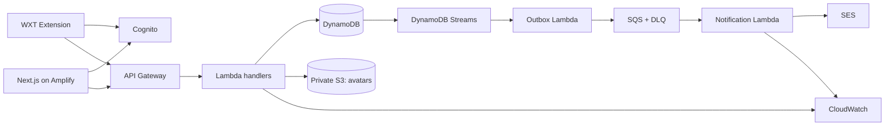

# Resolve — Master System Plan

> **Take every thought captive.**

**Project:** Resolve  
**Repository:** https://github.com/jervilangelo/resolve  
**Document version:** 1.0 · **Date:** 2026-11-23  
**Status:** Approved product intent / proposed technical design; not an implementation report  
**Source of truth:** This file. The root README summarizes it.

---

## 1. Executive brief and identity

Resolve is a Christian-inspired, privacy-first, voluntary browser protection and group-accountability product. Its name is inspired by Jonathan Edwards's *Resolutions* and its tagline by 2 Corinthians 10:5. The product assists intentional browsing and mutual encouragement; it does not claim to cause sanctification or replace human relationships.

**Goals:** (G1) locally obscure potentially explicit imagery; (G2) enforce a group-defined browser domain policy; (G3) let users freely choose whom to notify; (G4) preserve private browsing details; (G5) support Chromium and Firefox variants.

**Non-goals for MVP:** full device/OS protection; unbreakable extension enforcement; covert surveillance; browsing history storage; URL/screenshot emails; admin override of sharing; approval workflow for adding additional domains; uninstall or heartbeat alerts; doomscroll/focus tracking; general-purpose malicious site detection; mobile OS apps.

**Terminology:** “essential” = platform-protected group-blocking exemption; “non-negotiable” = admin-only group block that may generate alert; “additional” = group block any member may add, admin alone may remove; “recipient” = group member who explicitly consented to another member's accountability notifications; “active group” = one group selected for extension enforcement.

## 2. Requirement registry (normative)

| ID | Priority | Requirement | Verification |
|---|---|---|---|
| FR-01 | Must | Account signup/signin/email verification/recovery | Auth E2E |
| FR-02 | Must | Group name/picture, creation, invite, join, leave, removal | Membership E2E |
| FR-03 | Must | ADMIN and MEMBER roles; server-side role enforcement | Authorization matrix |
| FR-04 | Must | One selected active group per extension install; multiple memberships allowed | Switching test |
| FR-05 | Must | Platform essential-domain exemptions take precedence | Policy test matrix |
| FR-06 | Must | Only admins add/remove non-negotiable domains | 403 tests |
| FR-07 | Must | Admins and members add additional domains immediately, no approval | Submission test |
| FR-08 | Must | Only admins remove any group blocked domain | 403 tests |
| FR-09 | Must | Only admins enumerate full group domain list in standard UI/API | Leakage tests |
| FR-10 | Must | Member submission gives generic response, no duplicate/category oracle | Differential response test |
| FR-11 | Must | Browser-level blocking + versioned offline cache | Offline test |
| FR-12 | Must | On-device AI blur for images and feasible video frames | Network inspection + fixtures |
| FR-13 | Must | Sharing PRIVATE/SELECTED/EVERYONE per member | Policy E2E |
| FR-14 | Must | Explicit recipient consent; independent and bilateral selection | Consent matrix |
| FR-15 | Must | Admin cannot change member sharing | Authorization tests |
| FR-16 | Must | Eligible non-negotiable top-level navigation generates generic alert | Browser E2E |
| FR-17 | Must | Leave/removal generates generic alert using pre-departure policy | Transaction test |
| FR-18 | Must | Additional block matches do not generate alert | Negative test |
| FR-19 | Must | No URL/domain/title/screenshot/history in minimal events/emails | Payload/log audit |
| FR-20 | Must | Chrome, Brave, Edge, Firefox support with browser-specific adapters | Compatibility suite |
| FR-21 | Must | Idempotent event ingestion, dedupe, cooldown, retries, DLQ | Fault injection |
| FR-22 | Must | Users can revoke consent and sharing | Revocation race test |
| FR-23 | Should | User-facing protection status and local AI toggle | UI test |
| FR-24 | Should | Audit administrative rule and membership changes without browsing history | Audit review |

## 3. Stakeholders, roles, and lifecycle

**Actors:** anonymous visitor, authenticated user, group admin, group member, consenting notification recipient, platform operator, extension instance.

**Account lifecycle:** create Cognito account → verify email → complete profile → create/join group → select active group in extension → sync policies → optionally set sharing/consent → leave/remove → revoke group credentials and rules.

**Group lifecycle:** created by first admin → active → invited members join → group configuration changes increment `ruleVersion` → last-admin leave requires ownership transfer or dissolution → group deleted/archived per retention policy.

**Role matrix:**

| Operation | Admin | Member | Notes |
|---|---|---|---|
| Edit group name/picture | Allow | Deny | S3 signed upload path |
| Invite/remove members | Allow | Deny | Cannot silently impersonate member |
| Read membership list | Allow | Allow | Names/avatars only as needed |
| Read full blocked domains | Allow | Deny | Not in member APIs |
| Add non-negotiable domain | Allow | Deny | Admin alert category |
| Add additional domain | Allow | Allow | Immediate, no approval |
| Remove or reclassify any domain | Allow | Deny | Audit changes |
| Read/update own sharing | Allow | Allow | Owner only |
| Update another member's sharing | Deny | Deny | Even admin |
| Give/revoke own recipient consent | Allow | Allow | Owner only |
| Leave group | Allow* | Allow | *Last-admin transfer/dissolution |

**Invitations:** opaque random tokens stored hashed, expiration and optional use count, member role by default, redemption requires authenticated user, prevent replay. No implicit consent to notifications on joining.

## 4. Domain-policy engine

### 4.1 Categories and precedence

1. `ESSENTIAL_EXEMPTION`: maintained by platform; never overridden by group rules.
2. `NON_NEGOTIABLE`: admin-managed; blocks navigation; eligible for generic accountability alert.
3. `ADDITIONAL`: admin/member-submitted; blocks navigation; no alert by default.
4. Default: group policy allows navigation.

The essential registry initially targets Facebook (`facebook.com`, `fb.com`), Messenger (`messenger.com`), YouTube (`youtube.com`, `youtu.be`), Gmail (`gmail.com`, `mail.google.com`), Outlook (`outlook.com`, `outlook.live.com`, `outlook.office.com`), Google identity (`accounts.google.com`), Drive (`drive.google.com`), Meet (`meet.google.com`), Microsoft 365 (`office.com`, `microsoft365.com`), Teams (`teams.microsoft.com`), and verified dependencies. This is a **starter policy**, not an assertion that all required hosts are known. Validate service dependencies before finalizing.

**Rule precedence pseudocode:**

```ts
function decide(host: string, policy: CompiledPolicy): 'ALLOW'|'BLOCK_NON_NEGOTIABLE'|'BLOCK_ADDITIONAL' {
  const normalized = normalizeHostname(host);
  if (matchesEssential(normalized, policy.essential)) return 'ALLOW';
  if (matches(normalized, policy.nonNegotiable)) return 'BLOCK_NON_NEGOTIABLE';
  if (matches(normalized, policy.additional)) return 'BLOCK_ADDITIONAL';
  return 'ALLOW';
}
```

### 4.2 Input validation

- Accept domain hostnames, not raw URLs with path/query, arbitrary DNS resolver addresses, IPv4/IPv6, or arbitrary regular expressions in v1.
- Canonicalize case, trailing dot, IDNA/punycode, and whitespace; validate label lengths and public suffix boundaries.
- Exact-host and subdomain semantics must be explicit: `example.com` covers that host and its subdomains unless policy states otherwise.
- Reject attempts to block public suffixes and broad patterns that would encompass essential services, or compile narrowly scoped exceptions with exhaustive tests.
- Enforce rule quotas, per-user submission rate limits, and conflict-safe DynamoDB conditional writes.
- Member submission responses must not reveal duplicate existence, category, or who submitted the entry; no detailed timing oracle where practical.
- `NON_NEGOTIABLE` wins over `ADDITIONAL` when both exist; only admin may change category.

### 4.3 Rule synchronization and secrecy boundary

- Backend computes policy snapshot keyed by `groupId`, `ruleVersion`, and `essentialVersion`.
- Only active members can retrieve enforcement rules; use short-lived tokens and group membership checks.
- Extension persists a locally cached, validated snapshot with last-success timestamp and integrity/version checks.
- On network failure, continue using last valid rules and show stale-sync status; do not silently disable blocking.
- On membership revocation or group switch, clear previous group's cached rules, cancel queued syncs, and install the new effective policy.
- Standard member UI/API never enumerates the list. **Security reality:** extension rules on a user-controlled machine can be inspected or inferred. Encryption/obfuscation cannot provide absolute secrecy when the browser must enforce the rules.

### 4.4 Browser adapters

**Chromium:** `declarativeNetRequest` dynamic/session rules; assess maximum rule count, priorities, rule IDs, and extension permission prompts. **Firefox:** compatibility adapter, browser-specific API differences, and documented fallback where functionality differs. Build and test each target browser; do not assume parity.

**Critical:** `declarativeNetRequest.onRuleMatchedDebug` is not a reliable production notification source. Design a navigation-observation path using supported web navigation / tab APIs where permitted and correlate against compiled rules. Distinguish top-level user navigation from prefetches, subresources, auto redirects, and ads. When uncertain, block without alert. Do not claim perfect detection.

## 5. On-device AI media filtering

### 5.1 Candidate implementation

WXT content scripts observe DOM additions via `MutationObserver`, discover images and supported videos, and coordinate a local inference worker/queue. NSFWJS + TensorFlow.js is a candidate, subject to benchmark. Models are bundled with the extension where feasible; do not download arbitrary remote executable code.

### 5.2 Pipeline

1. Identify visible media and tag as pending; apply temporary blur where feasible.
2. Schedule inference with bounded concurrency and visibility-based prioritization.
3. Obtain image/frame pixels within browser security constraints.
4. Run local model, apply configurable conservative threshold and confidence policy.
5. Retain blur for likely sensitive content; release safe content; handle uncertain/unavailable content with documented fallback.
6. Recheck dynamic DOM changes, reused media elements, and video samples at a controlled cadence.

**Performance:** cap inference queue, avoid duplicate work with cache/fingerprints, unload models when idle, benchmark CPU/RAM and page responsiveness. **Privacy:** no image/frame upload, no classification telemetry containing content, no raw media persisted in browser storage. **Limitations:** CSS backgrounds, shadow DOM, canvas, cross-origin images, DRM video, iframe isolation, high frame rate, and false positives/negatives require explicit testing. Avoid overclaiming universal video blurring.

## 6. Accountability sharing and consent

### 6.1 Policy model

- `PRIVATE` — no accountability alert for this member.
- `SELECTED` — selected group recipient IDs, filtered by recipient acceptance.
- `EVERYONE` — every other group member who opted in to receive alerts.
- Default `PRIVATE`; users explicitly select a less private mode.
- Sender controls their own sharing; recipients independently consent to receive; admins cannot override either.
- One-way sharing is valid; bilateral is two independent one-way relationships.
- No alerts to external addresses in v1; no retroactive disclosure of prior events.

### 6.2 Recipient resolution

```ts
function eligibleRecipients(senderPolicy, activeMembers, consents) {
  if (senderPolicy.mode === 'PRIVATE') return [];
  const candidates = activeMembers.filter(m => m.userId !== senderPolicy.userId);
  const scoped = senderPolicy.mode === 'SELECTED'
    ? candidates.filter(m => senderPolicy.selectedRecipientIds.includes(m.userId))
    : candidates;
  return scoped.filter(m => consents.accepted(senderPolicy.userId, m.userId));
}
```

Consent changes take effect for **unsent jobs** too: revalidate consent before SES delivery. Keep an audit record of consent changes, without revealing browsing data.

## 7. Notification triggers (two core, two opt-in installation alerts)

### 7.1 Trigger A: qualifying non-negotiable navigation

**Flow:** user navigation → local rule match → browser blocks → supported top-level navigation observer determines eligibility → extension sends minimal signed/authenticated request → Lambda validates user and membership, applies event idempotency and rate limit → resolves sender sharing and recipient consent → records event and outbox → queue → SES generic email.

**Do not send:** hostname, URL, page title, screenshot, full history, query parameters, or raw browser request details. Minimal event example:

```json
{
  "eventId": "evt_opaque_random_id",
  "groupId": "grp_123",
  "eventType": "NON_NEGOTIABLE_NAVIGATION",
  "occurredAt": "2026-11-23T10:00:00Z",
  "clientRuleVersion": 12
}
```

Server derives user ID from token, not client-supplied user ID. `clientRuleVersion` is for validation/debugging without exposing rules. Never log request bodies containing untrusted extra fields; schema rejects unknown fields.

**Alert copy:** “A member of your accountability group triggered a non-negotiable website restriction.” Optional sender display name and group name; never visited domain. Use conservative wording: an extension-reported event is not proof of intent.

**Anti-spam:** idempotency on event ID; per-member event cooldown (e.g., configurable 10 minutes, final policy TBD); maximum notifications per recipient per hour; no repeated notifications for redirects or subresource matches. Maintain separate suppression metrics without URL content.

### 7.2 Trigger B: group departure/removal

**Flow:** user leaves or admin removes → Lambda validates operation → reads **pre-departure** sharing policy and consenting recipient snapshot → DynamoDB transaction updates membership and creates outbox record → Streams/outbox worker queues jobs → worker rechecks recipient membership/consent where applicable → SES sends generic departure alert.

This must not depend on a departing user's browser staying open. If the sender had `PRIVATE`, do not create an accountability notification. Selected/Everyone are evaluated from the policy **before** departure. A removed member's own consent does not authorize others to receive alerts; recipients' consents must exist.

**Alert copy:** “Alex has left Faithful Together.” or “Alex is no longer a member of Faithful Together.” Distinguish voluntary leave vs removal only if product/privacy policy explicitly allows it; generic wording is safer.

### 7.3 Reliable delivery

- Transactional outbox to avoid membership update succeeding while notification enqueue fails.
- DynamoDB Streams processor publishes SQS jobs with idempotency key (`eventId#recipientId`).
- Worker retries transient failures with exponential backoff, DLQ, CloudWatch alarms, and delivery-state updates.
- Recheck recipient consent and group authorization before sending.
- SES sandbox/production access, verified sender domain, bounce/complaint handling, SPF/DKIM/DMARC and unsubscribe/notification preferences.
- Acknowledge that external email systems can retain messages even after in-app data expires.

### 7.4 Opt-in installation alerts (added 2026-11-27, owner decision)

Two further alert types, **off by default on both sides**:

- **EXTENSION_REMOVED** — "Resolve was removed from one of [Name]'s browsers on [time]."
- **EXTENSION_INACTIVE** — "Resolve hasn't checked in from one of [Name]'s browsers since [time]."

**Consent.** In each group, the sender chooses per type whether to share it (on top of their sharing
mode and recipients), and each recipient chooses per type whether to receive it (on top of their
consent to that sender). The delivery worker re-checks membership, sharing, consent and both type
choices at send time. Payload and email: display name, event type and time (UTC); no group name,
website, URL, history or screenshot.

**Enrolment.** In the extension's settings the user turns on "Tell my partners if Resolve is removed
or stops checking in"; while signed in with an active group, the browser enrols for that group
(`POST /v1/extension/installations`, extension client only). The server returns an installation ID
and a 256-bit random token, storing only the token's SHA-256 hash. The extension registers
`runtime.setUninstallURL("<site>/removed#t=<token>")`: the token is in the fragment, so it never
reaches a server log, and the URL contains no account, email or group. Turning the setting off,
signing out or switching groups revokes the enrolment with `POST /v1/installations/revoke` (token as
the credential, so it works and is retried after sign-out) and clears the uninstall URL.

**Removal.** The browser opens the uninstall URL; the page relays the token to
`POST /v1/installations/removed` (no sign-in: the extension is gone). The API marks that one
installation removed with a conditional update (repeated callbacks change nothing), takes it out of
the inactivity scan and writes the outbox item in the same transaction. Other installations,
groups and the account are untouched. A removal made while offline is never reported; the
inactivity alert covers it later.

**Inactivity.** The enrolled extension checks in every 60 minutes (alarm) and at browser start,
authenticated with the user's token. The server keeps the next deadline (last check-in + 72 hours)
in a sparse GSI1 entry; an hourly scheduled Lambda alerts once per silent period (between 72 and 73
hours after the last check-in) and removes the entry; the next check-in restores it. A disabled
extension, a closed browser, a sleeping or offline computer all look the same, so the wording says
only when Resolve last checked in. 72 hours covers nights, weekends and short trips; it is a
constant (`INACTIVITY_GRACE_HOURS`).

## 8. Application surfaces and UX

### 8.1 Extension popup

Show AI filter status, domain protection status, active group, last rule sync, current sharing mode, quick access to add a domain, group dashboard link, and warnings for missing permissions/stale rules. Do not display the confidential group domain list to members.

### 8.2 Options page

Local filtering toggle and sensitivity (with clear risk language), browser permission explanations, account/device session, active group selection, sync troubleshooting, and accessible privacy policy. Prevent UI settings from implying the system cannot be bypassed.

### 8.3 Dashboard

**Public:** landing, mission, privacy, terms, documentation. **Authenticated:** profile, groups, invitations, membership list, sharing preferences, recipient consent. **Admin:** group branding, invitations, membership actions, complete domain list with categories and audit history. **Member:** domain submission form and generic success message; never list/count/categories.

### 8.4 Accessibility and design

Keyboard navigation, clear focus states, semantic controls, contrast, responsive mobile web dashboard, clear distinction between protection state and accountability sharing state. Branding: **Resolve** / *Take every thought captive.*; visual identity TBD.

## 9. AWS reference architecture



**AWS region:** configurable, with a likely initial `ap-southeast-1` deployment subject to service availability and cost. Separate `dev` and `prod` accounts or clearly isolated stacks. Terraform modules: Cognito, API Gateway, Lambda, DynamoDB, S3, SQS/DLQ, SES, IAM, observability, DNS/hosting.

**Secrets:** AWS Secrets Manager/SSM Parameter Store where needed, no credentials in client code, short-lived tokens, signed S3 upload URLs, private buckets, least-privilege IAM, environment-specific configuration. **Cost controls:** AWS Budgets alarms, CloudWatch retention, Lambda concurrency controls, SES/SQS quotas, DynamoDB on-demand initially with monitoring.

## 10. Data model and indexes

The following is a logical model; choose DynamoDB physical tables and GSIs from actual query patterns during implementation. Avoid unbounded scans and avoid storing browsing history.

| Entity | Primary key | Key fields | Access pattern |
|---|---|---|---|
| Users | `userId` | email reference, displayName, avatarKey, timestamps | Current profile |
| Groups | `groupId` | name, avatarKey, owner, status, ruleVersion | Group details |
| Memberships | `groupId#userId` or PK/SK | role, status, joinedAt | Members by group; groups by user via GSI |
| Invitations | `invitationId` | tokenHash, groupId, expiresAt, uses | Accept invite |
| ProtectedDomains | `domain` | service, essentialVersion | Platform policy registry |
| BlockedDomains | `groupId#domain` | type, submittedBy, createdAt | Admin list; compile group rules |
| SharingPolicies | `groupId#userId` | mode, selectedRecipientIds, updatedAt | Sender's policy |
| RecipientConsents | `groupId#senderId#recipientId` | accepted, updatedAt | Check consent, recipient preferences |
| ActivityEvents | `eventId` | senderId, groupId, eventType, occurredAt, expiresAt | Dedupe/short retention |
| NotificationOutbox | `eventId` | recipient IDs or refs, state, createdAt | Durable event dispatch |
| NotificationJobs | `eventId#recipientId` | state, attempts, lastErrorCode | Idempotent delivery |
| AuditChanges | `groupId#timestamp#id` | actorId, action, entityRef | Admin audit, no browsing data |

**Indexes:** memberships-by-user; invitations-by-group (optional); events-by-user for limited diagnostics if truly needed; outbox pending-state only if stream retry strategy requires. Use conditional writes, transactional writes for membership departure + outbox, TTL on transient event/job records, and encrypted data at rest.

**Data retention proposal (requires final approval):** minimal navigation event records 7–30 days; notification delivery metadata 30–90 days; security/admin audit 90 days; expired invitations automatically TTL-deleted; group data deleted on user/group deletion subject to operational/legal needs. These are proposals, not existing settings.

## 11. API contract (proposed v1)

Base `/v1`. Cognito JWT authorization for protected routes. Validate JWT issuer/audience/token use; use server-derived identity and Zod DTOs. Per-route authorization enforced in Lambda; never trust UI hiding alone.

| Method | Route | Role | Response / purpose |
|---|---|---|---|
| GET | `/me` | User | Own profile |
| PATCH | `/me` | User | Update own profile |
| POST | `/groups` | User | Create group + admin membership |
| GET | `/groups` | User | Own memberships |
| GET | `/groups/{groupId}` | Member | Group summary (no domains) |
| PATCH | `/groups/{groupId}` | Admin | Edit branding |
| POST | `/groups/{groupId}/invitations` | Admin | Issue invite |
| POST | `/invitations/{token}/accept` | Invited user | Join group |
| GET | `/groups/{groupId}/members` | Member | Member directory |
| POST | `/groups/{groupId}/leave` | Self | Leave and outbox |
| DELETE | `/groups/{groupId}/members/{userId}` | Admin | Remove and outbox |
| GET | `/groups/{groupId}/domains` | Admin | Full domain list |
| POST | `/groups/{groupId}/domains` | Member | Add additional; admin may specify type |
| DELETE | `/groups/{groupId}/domains/{domainId}` | Admin | Remove domain |
| PATCH | `/groups/{groupId}/domains/{domainId}` | Admin | Reclassify if supported |
| GET | `/groups/{groupId}/sharing` | Self | Own sharing state |
| PUT | `/groups/{groupId}/sharing` | Self | Set mode and selected recipients |
| GET | `/groups/{groupId}/consents` | Self | Consents relevant to self |
| PUT | `/groups/{groupId}/consents/{senderId}` | Recipient self | Accept/revoke sender alerts |
| GET | `/extension/rules?groupId=...&version=...` | Active member | Versioned enforcement snapshot |
| POST | `/extension/events` | Authenticated member | Minimal event ingestion |
| GET | `/notifications/preferences` | Self | Own email notification controls |

**Example member domain submission:**

```http
POST /v1/groups/grp_123/domains
Authorization: Bearer <access-token>
Content-Type: application/json

{"domain":"restricted-example.com","type":"ADDITIONAL"}
```

For members, backend must ignore/reject attempts to specify `NON_NEGOTIABLE` and never disclose whether the domain exists. Return uniform `202 Accepted` with `{ "message": "Submission received." }` after validation, or a generic policy rejection for essential domains. Consider response timing side channels. Admin receives richer operational errors.

**Example sharing policy:**

```json
{"mode":"SELECTED","selectedRecipientIds":["usr_2","usr_3"]}
```

**Error model:** `401` unauthenticated, `403` forbidden, `404` absent/inaccessible (avoid existence leaks), `409` for admin-visible conflict only, `422` invalid domain, `429` rate-limited, `5xx` server error. Include correlation IDs without logging sensitive client content.

## 12. Source tree and module responsibilities

```text
resolve/
├── README.md
├── docs/MASTER_PLAN.md
├── apps/
│   ├── extension/
│   │   ├── entrypoints/{background,content,popup,options}/
│   │   ├── features/ai-filter/{model-loader,media-observer,classifier,blur-controller}/
│   │   ├── features/domain-protection/{normalizer,rule-compiler,chromium-adapter,firefox-adapter}/
│   │   ├── features/accountability/{navigation-detector,event-client}/
│   │   ├── features/group-sync/{sync-client,local-cache}/
│   │   └── features/auth/session-manager/
│   └── dashboard/
│       ├── app/(public)/
│       ├── app/(auth)/
│       ├── app/(dashboard)/
│       └── components/
├── services/
│   ├── api/src/{auth,groups,memberships,domains,sharing,consents,events}/
│   └── notification-worker/src/{outbox,queue,delivery}/
├── packages/{contracts,policy-engine,ui,config}/
├── infra/terraform/{modules,environments/dev,environments/prod}/
├── tests/{unit,integration,e2e,security,browser-compat}/
└── .github/workflows/
```

**Engineering conventions:** TypeScript strict mode, shared Zod schemas, typed service boundaries, least privilege, structured non-sensitive logs, lint/format/typecheck/test gates, Dependabot or equivalent dependency scanning, code review for auth/policy/notification changes.

## 13. Threat model and security requirements

| Threat | Impact | Mitigation | Residual limitation |
|---|---|---|---|
| Member reads domain list via API | Privacy breach | Role checks, DTO filtering, no member list endpoint | Local rule inspection remains possible |
| Member reverse engineers extension rules | Reveals blocked hosts | UI non-disclosure, minimize exposed metadata | Cannot guarantee secrecy on owned device |
| Malicious member submits parent/wildcard domain | Essential services blocked | Domain normalization, protected overlap validation | Dependency gaps require updates |
| Forged navigation event | False accountability email | JWT, enrollment checks, rate limits, event validation | Client-side evidence not trustworthy proof |
| Automated redirects trigger alert | False accusation | Top-level navigation gating, conservative suppression | Some ambiguity persists |
| Admin attempts privacy override | Unauthorized disclosure | Policy ownership checks | Admin can still communicate outside app |
| Consent revoked before delivery | Unwanted email | Revalidate at send time | Already sent email cannot be recalled |
| Departure loses alert on crash | Missing notice | Transactional outbox + retries + DLQ | Email provider delivery not guaranteed |
| Browser offline | Stale restrictions | Cache last valid policy, sync indicator | New restrictions delayed |
| Extension disabled/uninstalled | Protection bypass | Honest status messaging; opt-in removal and inactivity alerts (§7.4) | Cannot prevent on personal device; offline removal and disabling are only seen as inactivity |
| Installation token leaked | False removal alert for that browser | 256-bit token in the URL fragment, hash stored, one alert per installation, revocable | A holder of the token can trigger one removal email |
| Telemetry accidentally logs URL | Privacy breach | Strict schemas, redaction, logging tests | Operational discipline required |
| S3 avatar upload abuse | Malware/cost | MIME/size checks, image processing, signed URLs, private bucket | Content moderation needed |

**Security controls:** HTTPS only, CSP, permissions minimization, CSRF protection where cookie-based sessions are used, CORS allowlist, S3 access control, KMS/AWS-managed encryption, IAM least privilege, API throttles, automated dependency updates, secret rotation, alerts on queue failure and auth anomalies.

**Privacy statement constraints:** Never claim that “no data is stored” globally. Resolve necessarily stores accounts, memberships, domain policies, consent, and limited delivery metadata. Correct claim: **browsing images/frames are processed locally and no browsing history or visited URLs are intentionally stored or sent in accountability events**. AWS may store the configured blocked-domain policy itself.

## 14. Test plan and acceptance gates

### 14.1 Unit tests

Domain canonicalization, essential overlaps, public suffix rejection, priority resolution, duplicate handling, sharing recipient resolution, consent revocation, event dedupe, TTL and outbox state transitions.

### 14.2 Integration tests

Cognito auth and role boundaries; member cannot GET/DELETE domain list; member can POST additional without approval; admin-only non-negotiable writes; membership deletion and outbox atomicity; SQS retry/DLQ; SES worker rechecks consent; stale rule sync behavior.

### 14.3 Browser E2E

Test Chrome, Brave, Edge, Firefox: image blur, dynamic images, supported video, iframe/cross-origin fallbacks, essential exemptions, domain blocks, top-level navigation alert vs background request, offline cached rules, group switching, revoked membership, permissions prompts, extension upgrade and crash recovery.

### 14.4 Privacy/security tests

Inspect all HTTP payloads and CloudWatch log templates; assert absence of URLs, hostnames, screenshots, titles and history from event/email paths; verify that member UI/API has no list/duplicate oracle; audit notification recipient consent; run dependency and IaC scans; attempt forged/replayed events.

### 14.5 MVP acceptance matrix

| Gate | Pass condition |
|---|---|
| AI privacy | No media upload during supported classification |
| Domain precedence | Essentials remain exempt even under broad group rules |
| Member write | Immediate additional domain add, no approval |
| Member secrecy | No normal UI/API enumeration, with honest local caveat |
| Admin control | Only admins remove or manage non-negotiable rules |
| Sharing | All 3 modes, selected and bilateral consent correct |
| Alert A | Only qualifying non-negotiable top-level navigation, generic content |
| Alert B | Departure/removal survives browser closure and uses pre-departure policy |
| Delivery | Idempotent, bounded retries, DLQ, consent recheck |
| Cross-browser | Critical flows pass in all four named browsers |

## 15. Delivery plan and dependencies

| Phase | Estimate | Work packages | Exit gate |
|---|---|---|---|
| P1 Foundation | Week 1 | Monorepo, CI, TypeScript, WXT shell, Next.js shell, Terraform dev | Local builds green |
| P2 AI | Weeks 2–3 | Media observer, model, blur, perf tests | Local blur demo, zero media upload |
| P3 Groups | Weeks 4–5 | Cognito, users, groups, invite/join/leave, role auth | Membership E2E |
| P4 Rules | Weeks 6–7 | Essential registry, normalization, admin/member APIs, sync, browser adapters | Policy matrix green |
| P5 Sharing | Week 8 | 3 modes, selected recipients, consent/revoke, bilateral | Consent matrix green |
| P6 Alerts | Weeks 9–10 | Navigation eligibility, departure transaction, outbox, SQS/SES | Both trigger tests green |
| P7 Hardening | Weeks 11–12 | Browser compatibility, security review, accessibility, load/cost | Critical defects closed |
| P8 Beta | Weeks 13–14 | Prod IaC, SES sender setup, browser packaging, documentation, beta | Limited user launch |

**Dependencies:** P1 before all; P3/P4 before P5/P6; P4 navigation instrumentation before alert A; P3 membership transaction before alert B; P7 before production beta. Parallelize AI model research with AWS foundation work. Estimated 10–14 weeks solo, subject to complexity and browser/store review.

### Implementation issue backlog (suggested)

- **EPIC-A:** Repo/CI/IaC/typed contracts
- **EPIC-B:** Local media pipeline and privacy instrumentation
- **EPIC-C:** Cognito, profile, group, invitation, role middleware
- **EPIC-D:** Essential registry, rule compiler, confidential member API, browser sync
- **EPIC-E:** Sharing policy, recipient consent, mutual selection
- **EPIC-F:** Navigation eligibility and minimal events; departure outbox; email worker
- **EPIC-G:** Cross-browser regression, abuse tests, observability, beta packaging

## 16. Operations and observability

**Metrics:** successful/failed rule syncs (no hostnames), API errors, authorization denials, queue depth/age, notification failures, DLQ count, SES bounces, Lambda duration, client AI inference latency aggregated locally or only with explicit opt-in and without content. **Alerts:** persistent DLQ backlog, elevated API 5xx, SES rejection/bounce spikes, failed deployment, high costs. **Runbooks:** SES suspension, queue replay with idempotency, group ownership recovery, policy rollback, compromised token, accidental broad block, consent complaint, data deletion request.

**Backups:** DynamoDB point-in-time recovery where justified, S3 versioning/lifecycle for avatars, Terraform state in encrypted remote backend with locking, protected CI secrets. **Release strategy:** dev/staging/prod separation, migration/version strategy for extension rules, canary beta, rollback to previous extension/backend version.

## 17. Decisions and open questions

### Confirmed product decisions

- Name **Resolve**; tagline **Take every thought captive.**; inspired by Jonathan Edwards's *Resolutions*.
- Local AI blurring, not cloud media inspection.
- Two roles: admin/member.
- Members add additional domains without approval; only admins remove.
- Full blocklist hidden from members in standard UI/API, with local technical limitation disclosed.
- Essential services protected from group blocking.
- Sharing modes Private/Selected/Everyone; bilateral optional; recipient consent.
- Two core notification triggers: non-negotiable navigation and group departure/removal; plus the opt-in installation alerts of §7.4 (2026-11-27).
- No browsing URLs/screenshots/history in notifications or event payloads.
- Browser targets Chrome/Brave/Edge/Firefox.

### Proposed engineering choices (validate before coding)

- WXT + React + TS, Next.js, Cognito, API Gateway/Lambda, DynamoDB, S3, SQS/SES, Terraform.
- NSFWJS + TF.js candidate; alternative on-device model if performance/accuracy insufficient.
- One active group per extension install.
- Event TTL, cooldown length, rule limits, and notification rate limits.
- Separate logical DynamoDB entities with query-driven physical design.
- Default private sharing and explicit recipient acceptance.

### Open questions / design spikes

1. How to identify qualifying user-initiated blocked top-level navigation consistently across all four browsers without debug-only APIs? Prototype before promising alerts.
2. How to safely implement essential-domain exemptions in DNR priority/rule quotas and Firefox equivalents?
3. What are the model size, accuracy, false-positive rates, cross-origin limitations, and video performance budgets?
4. What exactly counts as a protected essential host/dependency, and how is the registry updated securely?
5. What is the desired group invite expiry, max members, max domains, and last-admin dissolution UX?
6. What are the approved event retention, consent notification defaults, email frequency limits, and privacy/legal disclosures?
7. Is SES production access available, and which verified sending domain will be used?
8. Which browser stores and extension permissions are acceptable for v1 review?
9. What are acceptable privacy tradeoffs for showing member display names in notification emails?
10. How should a user's multiple groups behave across multiple browser profiles/devices?

## 18. Change control

For each material change, add a dated entry describing: **decision**, **reason**, **affected requirement IDs**, **security/privacy impact**, **migration impact**, and **test updates**. Do not silently reinterpret confirmed requirements when implementing.

### Change log

| Date | Version | Change |
|---|---|---|
| 2026-11-23 | 1.0 | Initial consolidated Resolve master plan and branded README |
| 2026-11-27 | 1.1 | **Decision:** add opt-in removal and inactivity alerts (§7.4), at the owner's request. **Reason:** partners asked to know when protection stops. **Affects:** §7 (no longer "exactly two"), §6 consent (per-type choices), §13 threats. **Privacy:** off by default on both sides; no browsing data; token-only uninstall URL; check-ins carry no browsing data. **Migration:** none (new items only). **Tests:** API, worker, email and extension unit tests; live checks on dev. |

---

**Guiding principle:** *Resolve should encourage meaningful accountability without turning private browsing into surveillance.*