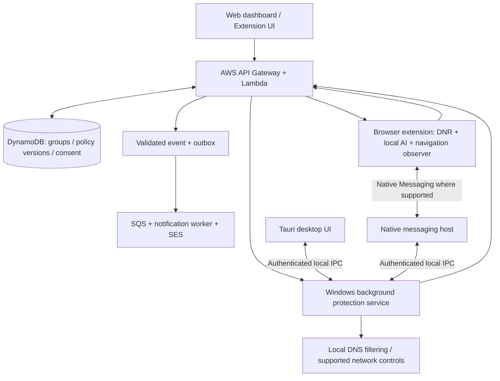

<!--
Resolve — Take every thought captive.
Copyright © Jervil Angelo De Leon. All rights reserved.
Proprietary source code. See LICENSE.
-->

# Resolve roadmap

> **Status: deferred.** Nothing on this page is built or promised. Resolve's production features
> are listed in the [README](../README.md#what-resolve-does); the delivered phases are recorded in
> [DEVELOPMENT_ROADMAP.md](DEVELOPMENT_ROADMAP.md). The ideas below are parked, with **2027** as a
> tentative time to revisit them. Each needs an owner decision, and changes to requirements go
> through [MASTER_PLAN.md](MASTER_PLAN.md) §18 before any code is written.

This is the one place for unshipped work. Add new ideas here, not in other documents.

## Contents

- [Desktop companion (Windows)](#desktop-companion-windows)
- [Browsers and distribution](#browsers-and-distribution)
- [Extension](#extension)
- [Dashboard and backend](#dashboard-and-backend)
- [Hardening](#hardening)
- [Open questions](#open-questions)

---

## Desktop companion (Windows)

**Deferred · revisit 2027 · Windows first.** An optional, explicitly installed Windows companion that
enforces the **same group restrictions** as the extension across supported network applications,
including private browser windows, and keeps enforcing when the extension or the desktop UI is
closed. It would not change the two accountability triggers and never authorises covert monitoring.

**Non-goals:** guaranteed tamper resistance on a user-administered device; hidden monitoring;
collecting browsing history; sending domains or URLs to accountability partners; bypassing
recipient consent; preventing emergency uninstall; deleting accounts on disable or uninstall;
universal coverage of VPNs, encrypted DNS, direct IP connections or every application.

### Reuse of what exists

| Existing component | Today | In the companion |
| --- | --- | --- |
| `apps/extension` | Browser blocking, on-device blurring, navigation observation, rule cache | Kept; stays the preferred source of navigation evidence |
| `apps/web` | Accounts, groups, domains, sharing and consent | Kept as the shared management UI |
| `packages/domain-policy` | Normalisation, essential exemptions, precedence | Canonical semantics; desktop rules compiled to match |
| `services/api` | Auth, membership, rule delivery, event validation | Adds device enrolment, desktop policy delivery, health and events |
| `services/notifications` | Outbox, SQS, SES, consent-aware delivery | Reused, with desktop-specific validation and deduplication |
| Terraform / AWS | Cognito, DynamoDB, API Gateway and more | Extended for device registration and observability if needed |

### Proposed shape

Repository additions: `apps/desktop/` (Tauri + React/TypeScript status UI),
`services/desktop-service/` (Windows Service in Rust or .NET, installed with consent),
`packages/desktop-protocol/` (versioned IPC, device status, policy and event schemas). The workspace
already includes `apps/*`, `services/*` and `packages/*`; native builds need their own CI toolchains.
The Windows Service is the long-running enforcer and lives independently of the UI. Media
blurring stays in the extension.

### Design notes to keep

- **One policy, two enforcement layers.** The AWS group policy is the single source of truth, never
  a hard-coded desktop list. The service fetches a device-authorised snapshot, compiles equivalent
  local rules, keeps a validated last-known-good copy for offline use, shows when it is stale, and
  removes a group's rules once a membership or group change is confirmed.
- **Separate desktop endpoint.** Do not reuse `GET /v1/extension/rules` by pretending the service is
  an extension. Define device enrolment, per-user active group, session refresh, token protection,
  revocation, multi-user Windows sessions and recovery before coding.
- **Same precedence.** Essential exemptions > admin non-negotiable > additional. Only admins remove
  domains; members gain no way to list them. Local rules on a user-controlled device can be
  inspected, so never promise absolute secrecy.
- **A native service cannot run the TypeScript policy code.** Build a tested desktop policy compiler
  (or a portable policy core) and prove semantic equivalence with `packages/domain-policy`.
- **DNS limits.** Hostname filtering cannot see URLs, paths or intent, and can miss cached DNS, direct
  IPs, VPNs, encrypted DNS, alternate resolvers and some apps. Validate shared dependencies so
  essential services keep working. Consider the Windows Filtering Platform only after a measured
  DNS proof of concept.
- **A DNS block is not an intentional visit.** It can come from subresources, prefetch, adverts,
  updates or another process.

| Event source | Can enforce? | Can send the existing deliberate-visit alert? |
| --- | --- | --- |
| Extension: qualifying top-level navigation | Yes | Yes, under existing eligibility and consent |
| Desktop DNS-only blocked lookup | Yes | **No, by default** |
| Desktop WFP-only blocked connection | Sometimes | **No, by default** |
| Desktop plus a trustworthy browser-aware signal | Yes | Candidate only, after security and privacy review |

If intent cannot be established, block without notifying. A separate opt-in "blocked connection"
alert category could be evaluated later, with its own wording ("an automatic connection may have
caused this"), consent, retention and schema; it must never silently reuse the existing trigger.
Group departure alerts stay unchanged; the extension's opt-in removal and inactivity alerts
(MASTER_PLAN §7.4) could later cover the desktop service too, but no alerts for blurring, Focus
Mode or ordinary DNS traffic without a separate decision.

**Eligible desktop event flow (browser-aware source only):** verify the source and policy version;
reject uncertain or automatic cases; send a minimal authenticated event to a dedicated route (no
URL, title, screenshot, media or history; any domain needed transiently for validation is never in
content or logs); the backend checks device and user, membership, rule category, sharing mode,
consent, idempotency, cooldown and cross-source deduplication; delivery reuses the outbox, SQS and
SES; one notification at most when the extension and desktop report the same event.

**Service and bypass resistance:** a signed service installed only with clear consent and elevation;
automatic start, failure recovery, bounded resources, visible status; least-privilege identity,
secure ACLs, signed updates, authenticated IPC, protected tokens, bounded logs, documented
uninstall and recovery. An optional managed-device mode would use administrator-controlled Windows
accounts with informed consent and emergency recovery. A local administrator can generally stop the
service or change network settings: never market it as impossible to bypass.

| Threat | Mitigation or limit |
| --- | --- |
| Extension disabled or removed | Service keeps enforcing; no automatic accusation |
| UI closed or PC restarted | Auto-start service with cached policy |
| DNS changed, VPN, encrypted DNS | Detect supported drift, show degraded status; evaluate WFP and policies |
| Local process impersonates the extension | Native Messaging allowlists, authenticated IPC, strict enrolment and schemas |
| Stolen desktop credential | OS-backed secret storage, short-lived credentials, revocation, rate limits |
| False alert | Browser-aware eligibility only; no DNS-only intent; deduplication |
| Member reads the full list | Restrict UI and API; disclose that local rules can be inspected |
| Admin uninstalls the service | Not preventable on an unmanaged personal device |

**Onboarding:** install with explicit elevation; enrol the device to the account; one active group
(as in the extension); verify sync and filtering; install the extension for blurring and navigation
signals; check private-window permission; show honest status (desktop filtering, browser blurring,
private-window permission, last sync, degraded conditions); separate opt-in for any new alert
category; clear disconnection, recovery, leave and uninstall paths that never delete the account.

### Dependencies and gates

0. **Specification:** scope, event semantics, threat model, consent, Windows signing and
   distribution, device identity, data minimisation, security review.
1. **Skeleton:** signed test installer, Tauri status UI, auto-starting service, secure IPC, safe
   uninstall; closing the UI or rebooting does not stop the service.
2. **Policy sync:** desktop enrolment and policy API; parity with the extension, group switching,
   revocation, offline cache.
3. **DNS proof of concept:** normal and private browsing across browsers; subdomains, precedence, DNS
   cache, VPN/DoH, direct IP, recovery, performance; document uncovered paths.
4. **Browser integration:** Native Messaging and health checks; the extension keeps blurring and its
   navigation semantics.
5. **Desktop event feasibility (go/no-go):** without robust browser-aware evidence, ship desktop
   blocking **without** desktop-only alerts.
6. **Notifications (conditional):** dedicated events, consent and deduplication tests, adversarial
   false-positive tests, redaction, rollback.
7. **Hardening and beta:** signing, ACLs, updates, recovery, multi-user, crash recovery, privacy
   tests, release notes, managed-device feasibility.

Minimum acceptance: a dashboard domain reaches the desktop policy without hard-coding; both layers
apply identical exemptions and precedence; closing the UI, restarting Windows or removing the
extension does not stop filtering (on supported setups); offline last-known-good holds; private
windows are filtered where the system resolver is used; a DNS-only block **never** sends a
deliberate-visit alert; uninstall and recovery stay available; no account is deleted automatically.

### Open questions

1. Platforms beyond Windows: macOS and Linux need their own service and filtering designs.
2. Active group: one shared active group across desktop and extension at first?
3. Desktop-only notifications: a research item, not a promise.
4. Consent: existing sharing and consent stay authoritative; any new category needs its own.
5. Managed mode: who holds administrator rights, and how does emergency recovery work?
6. Performance budgets for DNS latency, CPU, memory, battery and availability, from a prototype.
7. Governance: update the master plan, privacy policy and disclosures only if approved.

---

## Browsers and distribution

**Deferred · revisit 2027.**

- **Firefox:** Gecko ID and signing (on hold by owner request), sign-in, the enforcement adapter,
  media blurring without offscreen documents, alerts, and browser tests. The Firefox build compiles
  today but is not distributed.
- **Chrome Web Store and Microsoft Edge Add-ons:** Resolve is distributed directly (website and
  GitHub Releases). The listing copy, permission justifications and screenshots are ready in
  [release/STORE_LISTING.md](release/STORE_LISTING.md). Steps: the owner creates Chrome Web Store
  and Edge Partner Center accounts; create the items to get their IDs; set `store_extension_ids`
  in the production tfvars and apply; build the store zip without the beta key
  (`pnpm --filter @resolve/extension zip`); submit with the listing pack.
- **Phones and tablets:** not planned yet.

## Extension

**Deferred · revisit 2027.**

- **Focus Mode extras:** schedules, Pomodoro cycles, personal site lists, private statistics.
- **Resolve's blocked pages without alerts:** a separate "Show Resolve's blocked page" setting that
  asks for `webNavigation` on its own, with alerts tracked by their own flag. Today the pages show
  only when blocked-visit alerts are on (otherwise the browser's own block page appears).
- **Popup quick action** to add a website to the group (MASTER_PLAN §8.1).
- **Media blurring:** open shadow DOM, CSS background images, animated images beyond the checked
  frame, memory profiling, and a measured false-negative rate on a labelled dataset before making
  accuracy claims.
- **Deliberate-visit timing:** a visit started within 5 s of a page loading in the same tab is not
  reported (conservative by design); revisit with real usage.

## Dashboard and backend

**Deferred · revisit 2027.**

- Group picture upload (FR-02): the bucket exists; the flow is not built.
- Dissolve janitor: finish sweeps that ran out of time (leftovers are inert meanwhile).
- A membership-change audit alongside the domain and consent audit (FR-24).
- Per-user quota on how many groups one person can create.
- Bind the idempotency key to the request body (fingerprint).
- Clearer handling of revoked refresh tokens; return to the page you were on after a 401, with a
  loop guard; show "sign-in cancelled" rather than "link expired" when sign-in is cancelled.
- Leave or remove racing a role change answers 404 instead of 409.
- Server-rendered dates use UTC rather than the viewer's time zone.

## Hardening

**Deferred · revisit 2027** (accepted for now).

- Replace the deploy role's `PowerUserAccess` with a policy scoped to `resolve-<stage>-*`, and pin
  its OIDC trust to the deploy workflow on `main`.
- Move the dashboard session secret from Terraform state and Amplify variables to SSM or Secrets
  Manager.
- Give the beta build its own Cognito client, or drop the beta extension ID from production
  callbacks once a store build exists.
- Pin GitHub Actions by commit SHA.
- Lambda code signing and X-Ray tracing; customer-managed KMS keys if a compliance need appears;
  reserved concurrency per function; narrow the delivery worker's read of group metadata.

## Open questions

Carried over from [MASTER_PLAN.md](MASTER_PLAN.md) §17 where still open:

1. How should a person's several groups behave across browser profiles and devices?
2. Which permissions are acceptable for store review (see Browsers and distribution)?
3. What are the measured model accuracy and video performance budgets?
4. How is the essential-service registry updated securely over time?
